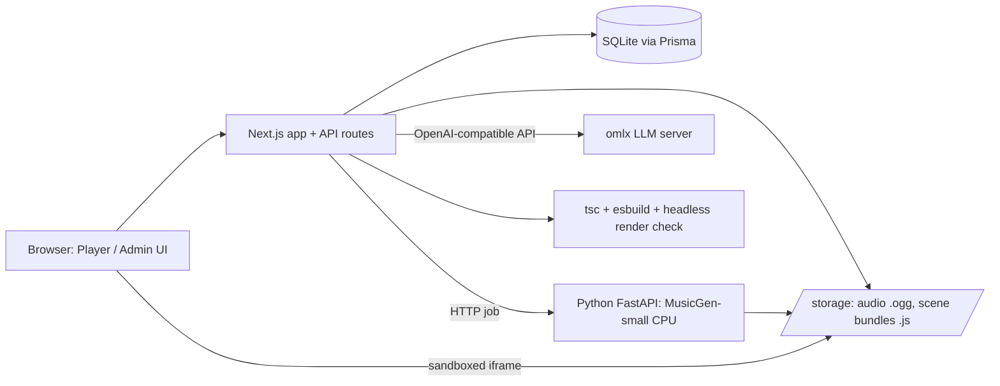

# TimeDrift — Implementation Plan (MVP)

> Status: **Documentation & preparation stage**. No coding yet. See [BACKLOG.md](BACKLOG.md) for the tasks assigned to each role.

## 1. Goal
TimeDrift is a web app (a Next.js PWA in English and Vietnamese). Anyone can open it and relax: they watch an animated line-art scene while relaxing music loops, for a fixed time.
- **Admin** creates music with a local AI model (MusicGen-small on CPU). Admin creates scenes with an LLM served by omlx, which writes code using the `line-art-animation` library. Admin pairs music and scenes into **templates**, matched by feeling tags.
- **Guest/free users** play templates or a random pair. Each run lasts 3–15 min (default 15). When it ends the player stops, and the user can start again right away. There is no daily cap.
- **Pro users** can set runs up to 720 min, choose any music and scene (custom pair), and build playlists.

## 2. Decisions
| Topic | Decision | ADR |
|---|---|---|
| Platform | Next.js 15 (App Router), TypeScript, Tailwind, installable PWA | ADR-001 |
| DB | SQLite via Prisma, on a single server | ADR-002 |
| Music gen | `facebook/musicgen-small`, CPU, Python FastAPI worker. Makes seamless 30–60s loops | ADR-003 |
| Scene gen | omlx at `http://10.1.123.123:8000/v1` (OpenAI-compatible). Default model `Qwen3.5-4B-3D-Coder`, fallback `gemma-4-12b-4bit` | ADR-004 |
| Scene delivery | Live SVG/TS bundle in an `<iframe sandbox="allow-scripts">` | ADR-005 |
| Auth | Guests need no login. Pro needs login (Auth.js: email magic link + Google) | ADR-006 |
| Payment | Mock for now: admin switches Pro on/off. A `PaymentProvider` interface is ready for VNPay/MoMo later | ADR-007 |
| Tags | One fixed list, managed by admin, shared by music and scenes, EN/VI names | ADR-008 |
| i18n | `next-intl`, EN + VI | — |
| Seed content | 5 hand-made scenes, 12 tags, 5 music prompts, 5 templates | — |

## 3. Architecture

Details: [architecture/ARCHITECTURE.md](architecture/ARCHITECTURE.md), [architecture/DATA_MODEL.md](architecture/DATA_MODEL.md), [architecture/API.md](architecture/API.md).

## 4. Business rules (summary)
- **R1** A free run lasts 3–15 min, default 15. When the timer ends the audio fades out over 10s, the scene pauses, and an "End" screen appears with buttons for Replay, Random and Back. There is no daily or total cap.
- **R2** A Pro run lasts 3–720 min.
- **R3** Custom pairs and playlists are Pro only. The server checks this on every request.
- **R4** A playlist's total minutes must be ≤ 720. Each item has its own minutes (3–720).
- **R5** Random picks a published template. If none exist, it picks a published scene and a published music track that share at least 1 tag.
- **R6** Template suggestions rank pairs by tag Jaccard overlap.
- **R7** Only `published` content is visible to users.
Full list (R1–R12): [ba/REQUIREMENTS.md](ba/REQUIREMENTS.md).

## 5. Phases & milestones
| Phase | Output | Main roles |
|---|---|---|
| P0 Prep (now) | All docs, AGENTS.md, backlog, design spec, prompt libraries | PM, BA, Director, Designer, Tech Lead |
| P1 Foundation | Scaffold, DB, auth, i18n, tags, seed scenes | Programmers, DevOps |
| P2 Content pipelines | Music worker, scene generation pipeline, admin UI | ML Eng, Backend, Audio Maker, Scene Artist |
| P3 User experience | Player, timer, random, templates, custom, playlists, PWA | Frontend, Designer |
| P4 Hardening | Tests, E2E, performance, a11y, release checklist | QA, DevOps |

## 6. Risks
| Risk | Mitigation |
|---|---|
| CPU MusicGen is slow (about 2–6 min per 30s clip) | Job queue with one job at a time, progress view, generate in batches overnight |
| A small LLM writes broken scene code | Strict contract, validate (typecheck → bundle → headless render), 2 retries that feed the error back, fallback model, admin edit step |
| Untrusted generated JS | Sandboxed iframe without same-origin, CSP, no network inside the scene |
| Audible seam in loops | Crossfade the tail into the head, plus an automated seam test |
| omlx server unreachable | Health check in the admin UI. Scene generation is disabled with a clear message |

## 7. Verification
- Unit (Vitest): rules R1–R7, tag matching, playlist validation.
- Python (pytest): loop seam continuity, output duration.
- Scene pipeline: a known-good module ends READY. A known-bad module retries and ends FAILED.
- E2E (Playwright): guest runs a 3-min template; free user is blocked from `/custom`; Pro user builds a playlist.
- Manual: generate music and a scene, build a template, play on desktop and mobile, switch EN/VI, install the PWA.
Details: [qa/TEST_PLAN.md](qa/TEST_PLAN.md).
