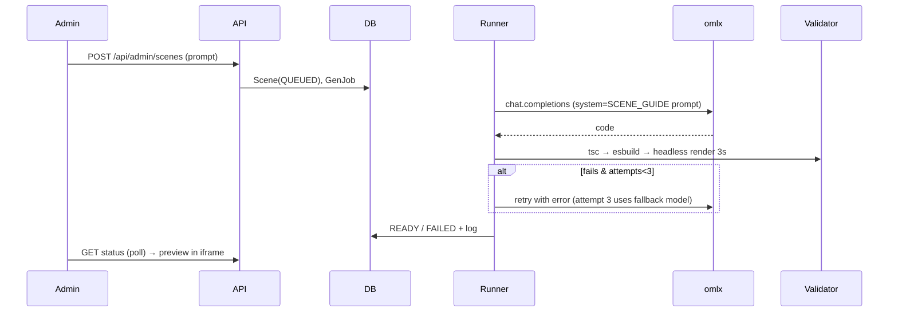
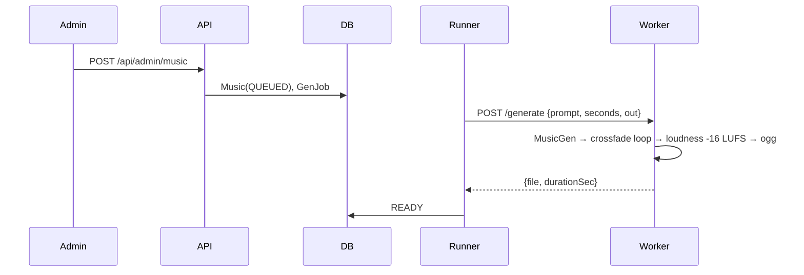

# Architecture (Owner: Tech Lead)

## Components
| Component | Tech | Responsibility |
|---|---|---|
| Web app | Next.js 15 (App Router, RSC) | User + admin UI, API routes, auth |
| Domain layer | `src/server/*` | Rules R1–R12, matching, playlist validation |
| DB | SQLite + Prisma | Metadata, users, jobs |
| Storage | Local disk `storage/` | `audio/<id>.ogg`, `scenes/<id>.bundle.js` |
| Music worker | Python FastAPI :8100 (`worker/music/`) | MusicGen-small CPU, loop crossfade, encode |
| LLM | Local llama.cpp worker (`worker/llm/`) or omlx on :8000 | Writes scene source using compact GGUF/omlx models |
| Scene validator | `tsc`, `esbuild`, Playwright-chromium | Typecheck, bundle, render check |
| Job runner | DB-backed serial runner (`src/server/jobs/runner.ts`) | Runs one music job and one scene job at a time, and resumes jobs after a restart |
| Scene host | `public/scene-host.html` | Runs bundles in a sandbox |

## Scene generation sequence

## Music generation sequence

## Player runtime
- Audio: Web Audio API. The track is decoded into an `AudioBuffer` and played by an `AudioBufferSourceNode` with `loop = true`, which gives gapless loops. Volume goes through a `GainNode`. Fades use `linearRampToValueAtTime`.
- Timer: based on `performance.now()` and the planned end time, so it stays correct even if the tab was throttled. When it ends, the R2 flow runs.
- Scene: an iframe that receives `{type:'play'|'pause'|'speed', value}` via postMessage.
- Wake Lock API while playing. Media Session API for lock-screen controls.

## Environments
`.env`: `DATABASE_URL`, `AUTH_SECRET`, `AUTH_GOOGLE_ID/SECRET`, `EMAIL_SERVER`, `LLM_BASE_URL`, `LLM_MODEL`, `LLM_FALLBACK_MODEL`, `MUSIC_WORKER_URL`, `STORAGE_DIR`. See [ops/SETUP.md](../ops/SETUP.md).
