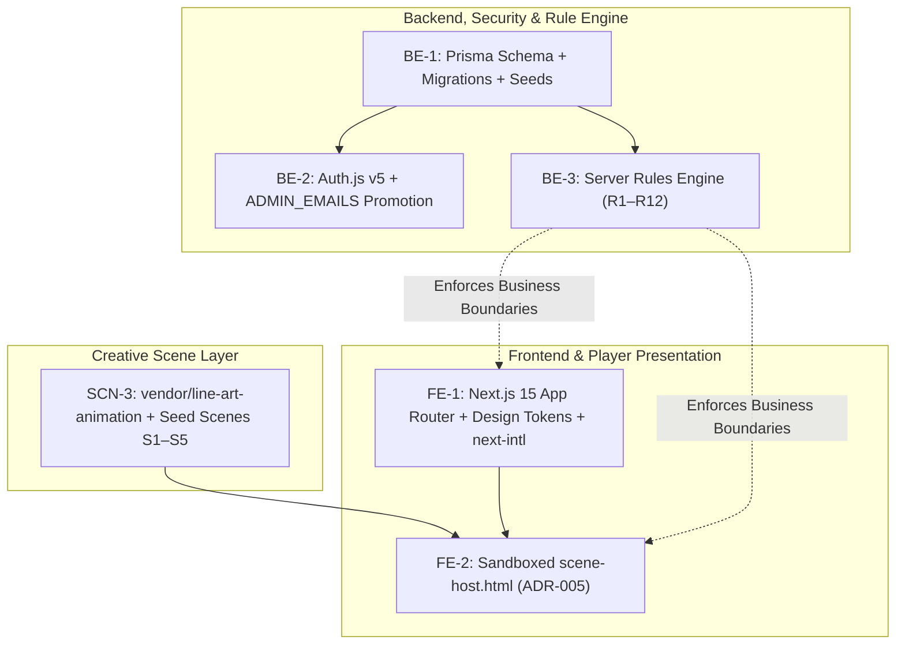
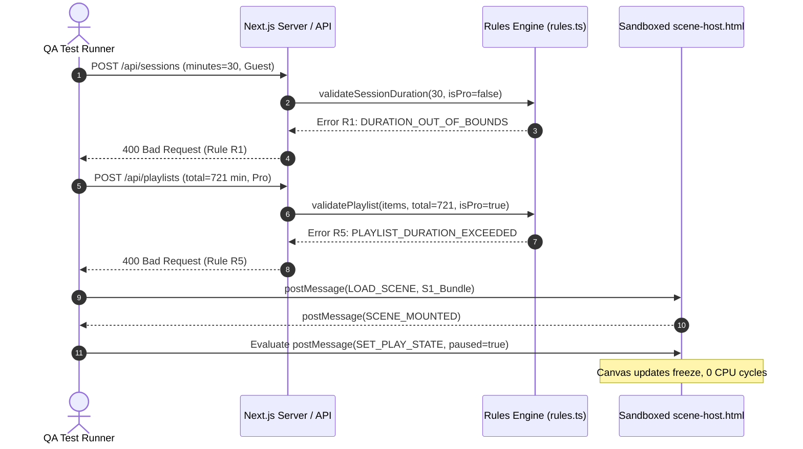

# Phase P1 User Requirements Document (URD): Foundation

**Document Version:** 1.0.0  
**Date:** 2026-11-18  
**Author:** Business Analyst (BA)  
**Status:** Approved for P1 Implementation  
**Direct Predecessors:** [P1_TARGETS.md](file:///Users/daothang/Documents/Projects/TimeDrift/docs/phases/P1_TARGETS.md), [REQUIREMENTS.md](file:///Users/daothang/Documents/Projects/TimeDrift/docs/ba/REQUIREMENTS.md), [TOKENS.md](file:///Users/daothang/Documents/Projects/TimeDrift/docs/design/TOKENS.md), [CREATIVE_BRIEF.md](file:///Users/daothang/Documents/Projects/TimeDrift/docs/creative/CREATIVE_BRIEF.md), [DATA_MODEL.md](file:///Users/daothang/Documents/Projects/TimeDrift/docs/architecture/DATA_MODEL.md), [SCENE_GUIDE.md](file:///Users/daothang/Documents/Projects/TimeDrift/docs/scenes/SCENE_GUIDE.md)

---

## 1. Executive Summary & Objective

The objective of **Phase P1: Foundation** is to transition TimeDrift from architectural specifications, design tokens, and creative briefs into a functioning, verifiable software foundation. 

This URD sets forth the exact functional requirements, technical contracts, error schemas, boundary conditions, and acceptance criteria for the six primary work packages of P1:
- **`FE-1`:** Next.js 15 App Router scaffold, Tailwind CSS tokens & day/night theme, next-intl EN/VI integration.
- **`BE-1`:** Prisma schema, SQLite migrations, and canonical seed loader (12 tags, S1–S5, M1–M5, 5 templates).
- **`BE-2`:** Auth.js v5 authentication, magic link + Google OAuth, `ADMIN_EMAILS` role promotion, and session guards.
- **`BE-3`:** Server-side rules engine (`src/server/rules.ts`) strictly enforcing R1–R12 with typed error schemas.
- **`SCN-3`:** Vendored `vendor/line-art-animation/`, `@timedrift/scene-api` contract, and handcrafted seed scenes S1–S5.
- **`FE-2`:** Sandboxed scene runtime host (`public/scene-host.html`) enforcing ADR-005, strict CSP, and bidirectional `postMessage` RPC.

---

## 2. Work Package Requirements & Acceptance Criteria



---

### 2.1. FE-1: Next.js 15 App Router Scaffold, Tailwind Tokens & Bilingual Setup

#### 2.1.1. Functional & Technical Requirements
1. **Next.js 15 App Router Setup:**
   - Framework: Next.js 15 (Turbopack / Webpack compatible), React 19, TypeScript strict mode (`strict: true`, `noImplicitAny: true`).
   - Route Structure: Locale-prefixed routing under `src/app/[locale]/...` (`en` and `vi`).
   - Root redirect: Accessing `/` evaluates browser `Accept-Language` or cookie `NEXT_LOCALE`, redirecting to `/[locale]`.
2. **Design Tokens & Tailwind Theme (`tailwind.config.ts`):**
   - Must implement all color tokens from [docs/design/TOKENS.md](file:///Users/daothang/Documents/Projects/TimeDrift/docs/design/TOKENS.md):
     - Day Mode: Paper base `#F4EFE6`, paper light `#FDFBF7`, paper dark `#EAE3D5`, sumi ink `#2B2A28`, ink soft `#635F59`, ink muted `#969188`, warm amber accent `#C28B38`, terracotta danger `#B5543C`.
     - Night Mode (`data-theme="night"`): Midnight paper `#161822`, paper light `#232734`, paper dark `#10121A`, bone ink `#EDE9DF`, ink soft `#A2A098`, ink muted `#585A66`, lantern glow accent `#F2C46D`, coral danger `#E07A5F`.
   - Dark Mode strategy: `darkMode: ['class', '[data-theme="night"]']`.
   - Transitions: Global 800ms transition curve (`--duration-daynight: 800ms`, `cubic-bezier(0.4, 0, 0.2, 1)`) for background and ink color shifts.
   - Max focal safe container: Utility class `max-w-focal-safe` mapped to `640px`.
3. **Typography & Vietnamese Diacritical Integrity:**
   - Fonts configured via `@next/font/google`:
     - Display: `Fraunces` (weights: 400, 600; optical sizing `9..144`).
     - Sans/Body: `Inter` (weights: 400, 500, 600).
   - Font subsets: Strictly `['latin', 'vietnamese']` to prevent Cumulative Layout Shift (CLS = 0) and misaligned diacritical glyphs (`hỏi, ngã, nặng, mũ`).
4. **Bilingual Integration (`next-intl`):**
   - Message dictionaries located at `messages/en.json` and `messages/vi.json`.
   - Strict 100% key parity between English and Vietnamese message trees.
   - Locale cookie persistence (`NEXT_LOCALE`) with 1-year max-age.
5. **Receding UI Behavior:**
   - Implement inactivity hook (`useRecedingUI(timeout = 4000)`) tracking mouse movements, taps, and keypresses.
   - On 4.0s of inactivity, controls transition to `opacity: 0` (`pointer-events: none`) using `--duration-recede: 800ms` (`cubic-bezier(0.16, 1, 0.3, 1)`).
   - Any user interaction instantly restores controls to `opacity: 1` (`--duration-normal: 250ms`).

#### 2.1.2. Acceptance Criteria (FE-1)
- [ ] `npm run dev` builds with zero TypeScript or ESLint errors.
- [ ] Toggling between `[data-theme="day"]` and `[data-theme="night"]` smoothly interpolates background and foreground over 800ms.
- [ ] Changing locale from `/en` to `/vi` updates all displayed navigation, common buttons, and metadata without missing key fallbacks.
- [ ] Vietnamese text renders all accented characters without fallback font substitution or broken vertical heights.
- [ ] Keyboard navigation displays visible focus ring (`ring-2 ring-accent ring-offset-2`).
- [ ] Player overlay chrome fades to invisible after 4000ms idle, reappearing immediately upon mouse move or keypress.

---

### 2.2. BE-1: Prisma Schema, Migrations & Canonical Seed Loader

#### 2.2.1. Functional & Technical Requirements
1. **Database Stack:**
   - Provider: SQLite (`DATABASE_URL="file:./dev.db"`).
   - ORM: Prisma Client with TypeScript generation.
2. **Data Model Entities:**
   - Must implement all models specified in [docs/architecture/DATA_MODEL.md](file:///Users/daothang/Documents/Projects/TimeDrift/docs/architecture/DATA_MODEL.md):
     - `User`: id, email (unique), name, role (`USER` | `ADMIN`), isPro (boolean), proUntil (DateTime?), locale (`en`), playlists relation.
     - `Tag`: id, slug (unique, kebab-case), nameEn, nameVi, relations to Music, Scene, Template.
     - `Music`: id, name, type, prompt, seconds (30 | 45 | 60), file, durationSec, status (`GenStatus`), published (boolean), tags relation.
     - `Scene`: id, name, description, prompt, sourcePath, bundlePath, model, status (`GenStatus`), published (boolean), isSeed (boolean), tags relation.
     - `Template`: id, name, musicId, sceneId, published (boolean), tags relation, onDelete: Restrict on music and scene.
     - `Playlist`: id, userId, name, items relation (Cascade delete).
     - `PlaylistItem`: id, playlistId, order (Int), templateId (optional), musicId (optional), sceneId (optional), minutes (3..720). Composite index on `[playlistId, order]`.
     - `GenJob`: id, kind (`music` | `scene`), targetId, status (`GenStatus`), attempts, model, log, timestamps.
     - Auth.js models: `Account`, `Session`, `VerificationToken`.
3. **Canonical Seed Script (`seed/seed.ts` via `npm run seed`):**
   - **Tags (12 canonical tags):** `calm`, `sleepy`, `focus`, `cozy`, `nostalgic`, `rainy`, `dreamy`, `warm`, `peaceful`, `morning`, `night`, `nature` with EN/VI names matching [docs/content/TAGS.md](file:///Users/daothang/Documents/Projects/TimeDrift/docs/content/TAGS.md).
   - **Scenes (S1–S5):**
     - S1: Lantern Village (*Làng đèn lồng*), tags: `nostalgic`, `night`, `warm`, `isSeed = true`, `published = true`, `status = READY`.
     - S2: Rainy Street (*Phố mưa*), tags: `rainy`, `calm`, `nostalgic`, `isSeed = true`, `published = true`, `status = READY`.
     - S3: Riverside Morning (*Sáng bên sông*), tags: `morning`, `peaceful`, `nature`, `isSeed = true`, `published = true`, `status = READY`.
     - S4: Window Desk (*Bàn bên cửa sổ*), tags: `focus`, `cozy`, `calm`, `isSeed = true`, `published = true`, `status = READY`.
     - S5: Starry Hill (*Đồi sao*), tags: `sleepy`, `night`, `dreamy`, `isSeed = true`, `published = true`, `status = READY`.
   - **Music (M1–M5):**
     - M1: Rainy Window, tags: `rainy`, `calm`, `nostalgic`, `seconds = 45`, `status = READY`, `published = true`.
     - M2: Paper Lanterns, tags: `night`, `sleepy`, `dreamy`, `seconds = 60`, `status = READY`, `published = true`.
     - M3: Morning Tea, tags: `morning`, `peaceful`, `cozy`, `warm`, `seconds = 45`, `status = READY`, `published = true`.
     - M4: Study Room, tags: `focus`, `cozy`, `calm`, `seconds = 60`, `status = READY`, `published = true`.
     - M5: Village Dusk, tags: `nostalgic`, `warm`, `night`, `seconds = 45`, `status = READY`, `published = true`.
   - **Templates (5 canonical templates):**
     - T1: *Lantern Evening / Tối đèn lồng* $\to$ S1 + M5 (shared: `nostalgic`, `warm`).
     - T2: *Rain on the Street / Mưa trên phố* $\to$ S2 + M1 (shared: `rainy`, `calm`, `nostalgic`).
     - T3: *River Dawn / Bình minh trên sông* $\to$ S3 + M3 (shared: `morning`, `peaceful`).
     - T4: *Deep Focus / Tập trung sâu* $\to$ S4 + M4 (shared: `focus`, `cozy`, `calm`).
     - T5: *Under the Stars / Dưới bầu trời sao* $\to$ S5 + M2 (shared: `night`, `sleepy`, `dreamy`).
     - All 5 templates created with `published = true`.
   - **Idempotency:** Re-running `npm run seed` updates existing records without duplication or primary key collision.

#### 2.2.2. Acceptance Criteria (BE-1)
- [ ] `npx prisma migrate dev` creates SQLite schema cleanly.
- [ ] `npm run seed` executes without error and inserts exactly 12 tags, 5 scenes, 5 music tracks, and 5 templates.
- [ ] Running `npm run seed` twice consecutively produces identical record counts (idempotent).
- [ ] Foreign key constraints are active: deleting an in-use Scene or Music throws a Prisma foreign key constraint failure.

---

### 2.3. BE-2: Auth.js v5 Setup, Providers, Admin Promotion & Session Guards

#### 2.3.1. Functional & Technical Requirements
1. **Auth.js v5 Implementation:**
   - Configured in `src/server/auth.ts` using `@auth/prisma-adapter`.
   - Supported Providers:
     - Email Magic Link (Resend or Nodemailer mock for dev).
     - Google OAuth (`AUTH_GOOGLE_ID`, `AUTH_GOOGLE_SECRET`).
2. **Guest Session Handling (ADR-006):**
   - Unauthenticated visitors operate as guests. No session record is required in SQLite for guest playback.
   - Guest timer bounds (3–15 min) are enforced at the API layer.
3. **Role Promotion (`ADMIN_EMAILS`):**
   - Upon sign-in or session token creation, the user's email is evaluated against the comma-separated `ADMIN_EMAILS` environment variable.
   - If `email` matches: `user.role` is set/updated to `Role.ADMIN` in the database.
   - If `email` does not match and current role is `ADMIN`, it is demoted to `Role.USER` unless locked.
4. **API & Route Middleware Guards:**
   - Middleware protects `/admin/:path*`:
     - Unauthenticated $\to$ redirect to `/[locale]/auth/signin?callbackUrl=/admin`.
     - Authenticated with `role !== 'ADMIN'` $\to$ HTTP 403 Forbidden.
   - API Guard functions in `src/server/guards.ts`:
     - `requireAuth(req)`: Returns active user or throws 401 `UNAUTHORIZED`.
     - `requirePro(req)`: Checks `isProActive(user)` (R9); throws 403 `PRO_REQUIRED`.
     - `requireAdmin(req)`: Checks `user.role === 'ADMIN'`; throws 403 `FORBIDDEN`.

#### 2.3.2. Acceptance Criteria (BE-2)
- [ ] Visiting `/admin` without authentication redirects to sign-in.
- [ ] User with email listed in `ADMIN_EMAILS` is automatically promoted to `role = ADMIN` upon sign-in.
- [ ] User with non-admin email receives 403 Forbidden when attempting to access `/admin` or `/api/admin/*`.
- [ ] Authenticated user object carries `isPro`, `proUntil`, and `role` in the session payload.

---

### 2.4. BE-3: Server Rules Engine (`src/server/rules.ts`) & Error Schemas

The server rules engine is the single authoritative source of truth for business rules R1–R12. Client-side UI only mirrors these rules.

#### 2.4.1. Rules Specification & Implementation Mapping

```typescript
// Standard Error Response Envelope
export interface RuleErrorResponse {
  error: {
    code: string;
    message: string;
    rule: string; // e.g. "R1", "R4", "R5"
    details?: Record<string, unknown>;
  };
}
```

1. **R1: Free Run Duration Bounds**
   - Condition: If user is Guest or Free (`isProActive === false`):
     - `minutes` must be an integer: $3 \le \text{minutes} \le 15$.
   - Rejection Error:
     ```json
     {
       "error": {
         "code": "DURATION_OUT_OF_BOUNDS",
         "message": "Free sessions must be between 3 and 15 minutes.",
         "rule": "R1",
         "details": { "min": 3, "max": 15, "requested": 30 }
       }
     }
     ```
2. **R2: Run Completion & Transition**
   - When wall-clock timer completes:
     - 10s audio fade-out linear ramp down to 0 volume.
     - Scene canvas loop pauses (`sceneHandle.pause()`).
     - Session state transitions to `COMPLETED`.
     - Immediate replay or subsequent run allowed; zero daily or cumulative rate limits.
3. **R3: Pro Run Duration Bounds**
   - Condition: If user has active Pro (`isProActive === true`):
     - `minutes` must be an integer: $3 \le \text{minutes} \le 720$.
   - Rejection Error (if minutes > 720 or minutes < 3):
     ```json
     {
       "error": {
         "code": "DURATION_OUT_OF_BOUNDS",
         "message": "Pro sessions must be between 3 and 720 minutes.",
         "rule": "R3",
         "details": { "min": 3, "max": 720, "requested": 721 }
       }
     }
     ```
4. **R4: Pro-Gated Routes & Features**
   - Guard: Access to Custom Pair (`/custom`, `POST /api/sessions/custom`) and Playlists (`/playlists`, `/api/playlists/*`) requires active Pro.
   - Non-Pro Error:
     ```json
     {
       "error": {
         "code": "PRO_REQUIRED",
         "message": "Custom pairing and playlists require an active Pro subscription.",
         "rule": "R4"
       }
     }
     ```
5. **R5: Playlist Constraints**
   - Bounds:
     - Item count: $1 \le N \le 50$.
     - Item duration: $3 \le \text{minutes} \le 720$ for each item.
     - Cumulative duration: $\sum_{i=1}^N \text{item}_i.\text{minutes} \le 720$ minutes.
     - Target structure: Each item must be either a `templateId` OR (`musicId` AND `sceneId`) — strictly mutually exclusive (XOR).
   - Rejection Errors:
     - If total > 720: code `PLAYLIST_DURATION_EXCEEDED` (rule "R5").
     - If count < 1 or count > 50: code `PLAYLIST_ITEM_COUNT_INVALID` (rule "R5").
     - If item target invalid: code `PLAYLIST_ITEM_TARGET_INVALID` (rule "R5").
6. **R6: Deterministic Random Selection Algorithm**
   - Input: `lastPlayedTemplateId?: string`, `lastPlayedSceneId?: string`.
   - Algorithm Steps:
     1. Query all published templates (`published = true`).
     2. If pool $> 1$, filter out item where `id === lastPlayedTemplateId`. Pick uniformly at random.
     3. If no published templates exist:
        a. Query published scenes (`published = true`). Exclude `lastPlayedSceneId` if pool $> 1$. Pick random scene $S$.
        b. Query published music sharing $\ge 1$ tag with $S$. If found, pick random music $M$ from set.
        c. If no music shares a tag, pick any published music $M$ uniformly at random. Return pair $(S, M)$.
     4. If total eligible content is empty, throw `NO_PUBLISHED_CONTENT` error.
7. **R7: Template Suggestion Score (Jaccard Index)**
   - Formula:
     $$Jaccard(S, M) = \frac{|S_{\text{tags}} \cap M_{\text{tags}}|}{|S_{\text{tags}} \cup M_{\text{tags}}|}$$
   - Sort: Descending by score.
   - Filter: Pairs where $Jaccard < 0.2$ are hidden by default unless explicitly queried with `showAll = true`.
8. **R8: Publication Integrity Constraints**
   - A Template cannot be updated to `published = true` unless:
     - `template.scene.published === true` AND `template.music.published === true`.
   - If either is unpublished:
     ```json
     {
       "error": {
         "code": "UNPUBLISHED_DEPENDENCY",
         "message": "A template can only be published if both its scene and music are published.",
         "rule": "R8",
         "details": {
           "scenePublished": false,
           "musicPublished": true
         }
       }
     }
     ```
9. **R9: Pro Status Evaluation & Mid-Session Expiry**
   - Active status check:
     $$\text{isProActive}(user) \iff user.\text{isPro} = \text{true} \land (user.\text{proUntil} = \text{null} \lor user.\text{proUntil} > \text{now})$$
   - Mid-session grace: If Pro expires during an active session run, the active session is permitted to run until its scheduled end time. The next session initialization strictly evaluates current Pro status.
10. **R10: Music Generation & Duration Integrity**
    - Audio duration must strictly equal 30, 45, or 60 seconds (`seconds in [30, 45, 60]`).
    - Music can only transition to `published = true` if `status === 'READY'`.
11. **R11: Scene Validation Gate**
    - Scene can only transition to `published = true` if `status === 'READY'`.
    - Any modification to `sourcePath` resets status to `VALIDATING` and triggers validation pipeline.
12. **R12: Deletion & Unpublishing Cascades**
    - Hard deletion of a Music or Scene record that is referenced by any Template or Playlist item is blocked:
      ```json
      {
        "error": {
          "code": "CONFLICT_IN_USE",
          "message": "Cannot delete content that is in use by templates or playlists.",
          "rule": "R12",
          "details": {
            "templateCount": 2,
            "playlistItemCount": 1
          }
        }
      }
      ```
    - Unpublishing behavior: If a Scene or Music is unpublished (`published = false`), any dependent playlist item is gracefully skipped during playback with a 1-second crossfade to the next item.

#### 2.4.2. Acceptance Criteria (BE-3)
- [ ] `src/server/rules.ts` exports pure validation functions: `validateSessionDuration`, `validatePlaylist`, `selectRandomDrift`, `calculateJaccardScore`, `validatePublishTemplate`, `isProActive`, `canDeleteContent`.
- [ ] 100% Vitest unit test coverage covering valid inputs and boundary violations for R1–R12.
- [ ] Error objects match `RuleErrorResponse` structure with appropriate HTTP status codes (400, 403, 409).

---

### 2.5. SCN-3: Vendored Lib, `@timedrift/scene-api` Types & Seed Scenes S1–S5

#### 2.5.1. Functional & Technical Requirements
1. **Vendored Animation Library:**
   - Source: `vendor/line-art-animation/` vendored cleanly from `github.com/JDhruv14/line-art-animation` (MIT).
   - Core modules exposed in `vendor/line-art-animation/lib`:
     - `ink.ts`: SVG path drawing primitives, limb generation, ink definitions.
     - `gait.ts`: Human locomotion cycles and skeletal poses.
     - `motion.ts`: Organic oscillation, harmonic easing, and physics routines.
     - `daynight.ts`: Palette calculation functions: `palette(tau)` and `applyPalette(svg, tau)`.
2. **TypeScript Scene Contract (`@timedrift/scene-api`):**
   - Package/module types defined in `src/types/scene-api.ts`:
     ```typescript
     export interface SceneOpts {
       seed: number;         // Deterministic PRNG seed (Mulberry32)
       dayLengthSec: number; // Duration of full day/night cycle in seconds (default 900)
       startTau: number;     // Starting point: 0..1 (0.0 = midnight, 0.25 = dawn, 0.5 = noon, 0.75 = dusk)
       reducedMotion: boolean;
     }

     export interface SceneHandle {
       pause(): void;
       resume(): void;
       setSpeed(mult: number): void; // Range 0.25..1.0
       destroy(): void;
     }

     export type SceneMountFn = (svg: SVGSVGElement, opts: SceneOpts) => SceneHandle;
     ```
   - Rules:
     - Root SVG `viewBox` must be strictly `0 0 1920 1080`.
     - Center-third focal safe zone: essential characters and narrative art must reside within horizontal band $640 \le X \le 1280$.
     - Maximum simultaneous animated figures: $\le 6$.
     - Gait speed multiplier $\le 0.6\times$; cycle period $> 2.0\text{s}$.
     - Zero raw `Math.random()`: all stochastic offsets must use Mulberry32 seeded by `opts.seed`.
     - Zero DOM access outside the provided `svg` container; zero network access (`fetch`, `xhr`, `WebSocket`).
3. **Handcrafted Seed Scenes (S1–S5):**
   - **S1: Lantern Village (*Làng đèn lồng*):**
     - Bamboo hillside grove with 2 strolling villagers ($\text{gait} \le 0.5\times$).
     - Ambient lanterns illuminate smoothly as $\tau$ transitions from dusk to night (`#F2C46D`).
     - Damped harmonic pendulum wind chime swaying ($T \approx 4.0\text{s}$).
   - **S2: Rainy Street (*Phố mưa*):**
     - Diagonal fine-line rain streaks across sumi wash pavement.
     - Lone umbrella walker crossing unhurriedly ($T \ge 6.0\text{s}$).
     - Puddle ripples expanding concentrically under lantern glow.
   - **S3: Riverside Morning (*Sáng bên sông*):**
     - Wide calm river at dawn; wooden sampan boat drifting with sinusoidal heave ($T \approx 5.5\text{s}$).
     - Fisherman casting in silhouette; two birds soaring in wide leisurely arcs.
   - **S4: Window Desk (*Bàn bên cửa sổ*):**
     - Interior windowsill overlooking changing twilight sky.
     - Teacup with rising steam using 5th-order minimum-jerk fluid drift.
     - Resting cat with subtle breathing cycle ($T \approx 4.5\text{s}$) and occasional tail flick.
   - **S5: Starry Hill (*Đồi sao*):**
     - Ancient pine silhouette swaying on a grassy knoll ($T \approx 3.8\text{s}$).
     - Floating fireflies exhibiting Brownian trigonometric drift.
     - Deep night sky with twinkling stars breathing via smooth sinusoidal opacity.

#### 2.5.2. Acceptance Criteria (SCN-3)
- [ ] All 5 seed scenes compile cleanly with `tsc --noEmit` against `@timedrift/scene-api`.
- [ ] Each seed scene mounts on an SVG element, returns `SceneHandle`, and runs for 60 seconds without JavaScript errors.
- [ ] `pause()`, `resume()`, `setSpeed()`, and `destroy()` perform as specified without memory leaks.
- [ ] When cropped to 9:16 portrait viewport, primary storytelling elements remain fully visible inside the central 640px column.
- [ ] Motion responds to `reducedMotion: true` by slowing kinematics to $\le 0.25\times$.

---

### 2.6. FE-2: Sandboxed Scene Runtime Host (`public/scene-host.html`)

#### 2.6.1. Functional & Technical Requirements
1. **Iframe Isolation & CSP Security (ADR-005):**
   - Location: Static file served from `public/scene-host.html`.
   - Embedder markup:
     ```html
     <iframe
       sandbox="allow-scripts"
       src="/scene-host.html"
       class="w-full h-full border-0 absolute inset-0 pointer-events-none"
       tabindex="-1"
       aria-hidden="true"
     ></iframe>
     ```
   - Strict Content Security Policy meta tag:
     ```html
     <meta
       http-equiv="Content-Security-Policy"
       content="default-src 'none'; script-src 'self' 'unsafe-inline'; style-src 'unsafe-inline'; img-src 'self' data:; connect-src 'none';"
     />
     ```
   - Attributes `allow-same-origin`, `allow-top-navigation`, `allow-popups`, and `allow-modals` are strictly prohibited.
2. **SVG ViewBox & Responsive Presentation:**
   - Root SVG element: `viewBox="0 0 1920 1080"` and `preserveAspectRatio="xMidYMid slice"`.
   - Fullscreen container scaling seamlessly to desktop ultra-wide (21:9), desktop 16:9, tablet (4:3), and mobile portrait (9:16).
3. **RPC postMessage Protocol:**
   - Host listens to parent messages and emits lifecycle notifications:
   
   | Message Direction | Action Type | Payload Structure | Description |
   |---|---|---|---|
   | Host $\to$ Parent | `HOST_READY` | `{ timestamp: number }` | Host environment initialized and ready for bundle load. |
   | Parent $\to$ Host | `LOAD_SCENE` | `{ bundleUrl: string, opts: SceneOpts }` | Injects ES module bundle script and invokes default mount. |
   | Host $\to$ Parent | `SCENE_MOUNTED` | `{ sceneId?: string }` | Scene mounted successfully without runtime errors. |
   | Host $\to$ Parent | `SCENE_ERROR` | `{ message: string, stack?: string }` | Trapped script execution or mount error. |
   | Parent $\to$ Host | `SET_PLAY_STATE` | `{ paused: boolean }` | Calls `handle.pause()` or `handle.resume()`. |
   | Parent $\to$ Host | `SET_SPEED` | `{ speed: number }` | Adjusts animation speed factor ($0.25 \le \text{speed} \le 1.0$). |
   | Parent $\to$ Host | `UPDATE_TAU` | `{ tau: number }` | Dynamic time of day ($0.0 \le \tau < 1.0$). |
   | Parent $\to$ Host | `DESTROY` | `{}` | Cleans up canvas/SVG and destroys scene instance. |

4. **Performance & Stability Protections:**
   - Delta time clamping: Frame interval $\Delta t$ clamped to $\min(0.1\text{s}, \text{raw\_dt})$ to prevent animation tear when tab is restored from background.
   - Error trapping: `window.addEventListener('error')` and `unhandledrejection` report back to parent via `SCENE_ERROR`.

#### 2.6.2. Acceptance Criteria (FE-2)
- [ ] Direct inspection of `scene-host.html` verifies CSP `default-src 'none'; connect-src 'none'`.
- [ ] Attempting `fetch()` or `window.parent.location` inside scene host throws a security exception.
- [ ] Loading bundle via `LOAD_SCENE` successfully mounts S1–S5 inside the host SVG.
- [ ] Sending `SET_PLAY_STATE paused=true` stops animation frame updates; `paused=false` resumes without time jump.
- [ ] Passing continuous $\tau \in [0, 1)$ smoothly transitions day/night palettes without visual stutter.
- [ ] Memory footprint remains stable ($< 50\text{MB}$ delta over 10 minutes of continuous playback).

---

## 3. Bilingual Terminology & UI Translation Glossaries

All bilingual strings must maintain identical key paths across both locales:

### 3.1. Core Vocabulary Mapping
| Term Key | English (EN) | Vietnamese (VI) | Context & Usage |
|---|---|---|---|
| `brand.name` | TimeDrift | TimeDrift | Unchanging brand identifier |
| `brand.tagline` | Drift into stillness | Trôi vào tĩnh lặng | Homepage headline & meta description |
| `nav.sanctuary` | Sanctuary | Không gian thư giãn | Primary template showcase |
| `nav.custom` | Harmonize | Tự chọn giai điệu | Custom pair workspace (Pro) |
| `nav.playlists` | Journeys | Hành trình | Playlist workspace (Pro) |
| `nav.admin` | Drift Studio | Xưởng sáng tạo | Admin dashboard |
| `tier.guest` | Guest | Khách | Unauthenticated visitor |
| `tier.free` | Free | Miễn phí | Authenticated free account |
| `tier.pro` | Pro Sanctuary | Gói Tĩnh Tại | Pro subscription tier |
| `common.duration` | {count, plural, =1 {1 minute} other {# minutes}} | {count} phút | Session duration format |

### 3.2. Error Messages & Rule Prompts
| Rule Reference | Translation Key | English (EN) | Vietnamese (VI) |
|---|---|---|---|
| **R1** | `errors.duration_free` | Free sessions must be between 3 and 15 minutes. | Phiên trải nghiệm miễn phí kéo dài từ 3 đến 15 phút. |
| **R3** | `errors.duration_pro` | Pro sessions can last up to 12 hours (720 minutes). | Phiên Tĩnh Tại có thể kéo dài tối đa 12 giờ (720 phút). |
| **R4** | `errors.pro_required` | This feature is exclusively available in Pro Sanctuary. | Tính năng này dành riêng cho thành viên Gói Tĩnh Tại. |
| **R5** | `errors.playlist_max_duration` | A journey cannot exceed 720 minutes in total. | Tổng thời lượng một hành trình không thể vượt quá 720 phút. |
| **R5** | `errors.playlist_max_items` | A journey can contain at most 50 steps. | Một hành trình có thể chứa tối đa 50 bước trải nghiệm. |
| **R8** | `errors.unpublished_dependency` | Cannot publish template while scene or melody remains unpublished. | Không thể xuất bản không gian khi hoạt cảnh hoặc giai điệu chưa được công khai. |
| **R12** | `errors.item_in_use` | Cannot delete content currently included in active templates or journeys. | Không thể xóa nội dung đang được sử dụng trong các không gian hoặc hành trình. |

---

## 4. P1 Quality Assurance & Director Verification Scenarios

Before Phase P1 is marked `DONE` and work on Phase P2 begins, the QA Engineer and Project Director will execute the following deterministic test scenarios:

### 4.1. QA Automated & API Verification Scenarios



| ID | Test Scenario | Execution Method | Expected Result | Pass Criteria |
|---|---|---|---|---|
| **P1-QA-01** | Rule R1 Free Session Upper Bound | `POST /api/sessions` with `minutes = 16`, unauthenticated. | HTTP 400 with code `DURATION_OUT_OF_BOUNDS`, rule `"R1"`. | Rejection is instantaneous; no session record created. |
| **P1-QA-02** | Rule R1 Free Session Lower Bound | `POST /api/sessions` with `minutes = 2`, unauthenticated. | HTTP 400 with code `DURATION_OUT_OF_BOUNDS`, rule `"R1"`. | Rejection verified. |
| **P1-QA-03** | Rule R3 Pro Upper Bound | `POST /api/sessions` with `minutes = 720` for Pro user. | HTTP 200 / 201 Created. | Session succeeds. `minutes = 721` returns HTTP 400. |
| **P1-QA-04** | Rule R4 Pro Route Protection | `GET /api/custom` and `POST /api/playlists` without Pro token. | HTTP 403 Forbidden with code `PRO_REQUIRED`, rule `"R4"`. | Zero catalog data or playlist structures leaked. |
| **P1-QA-05** | Rule R5 Playlist Total Cap | Validate playlist with 3 items of 250 min each (total 750 min). | Validation fails with `PLAYLIST_DURATION_EXCEEDED`. | Total accumulator stops save operation. |
| **P1-QA-06** | Rule R6 Random Non-Repetition | Execute `selectRandomDrift` 50 times against seed templates. | `result.id !== lastPlayedId` in 100% of consecutive pairs. | True uniform randomness over remaining set. |
| **P1-QA-07** | Rule R7 Jaccard Index Accuracy | Calculate Jaccard score for S1 (nostalgic, night, warm) and M5 (nostalgic, warm, night). | Score = 1.0 (3/3). Pair with 1 of 5 shared tags scores 0.20. | Mathematical calculation verified. |
| **P1-QA-08** | Rule R8 Publish Guard | Attempt to publish template when `scene.published = false`. | HTTP 409 with code `UNPUBLISHED_DEPENDENCY`, rule `"R8"`. | Database state unaltered. |
| **P1-QA-09** | Rule R9 Pro Mid-Session Expiry | Start 60-min session with `proUntil = now + 5 min`. | Session completes at 60 min. Subsequent session restricted to 15 min. | Active run protected; future run restricted. |
| **P1-QA-10** | Rule R12 Cascade Deletion Guard | Attempt to delete scene S1 referenced by Template T1. | HTTP 409 Conflict with code `CONFLICT_IN_USE`, rule `"R12"`. | Rejection details list Template T1 as dependent. |
| **P1-QA-11** | Sandboxed CSP Network Block | Execute `fetch('https://example.com')` inside `scene-host.html`. | Browser security error thrown; network request aborted. | Zero external requests dispatched. |
| **P1-QA-12** | Host postMessage RPC Contract | Dispatch `SET_PLAY_STATE`, `SET_SPEED`, `UPDATE_TAU`, `DESTROY`. | Host responds with expected state transitions; no uncaught exceptions. | Bidirectional RPC functional. |

---

### 4.2. Director Aesthetic & Creative Sign-Off Scenarios

| ID | Inspection Scenario | Target Deliverable | Visual / Sensorial Standard | Director Verdict |
|---|---|---|---|---|
| **P1-DIR-01** | Washi & Sumi Palette Verification | `FE-1` Design Tokens | Colors inspect exactly `#F4EFE6` (day) and `#161822` (night). Contrast passes WCAG AAA. No digital pitch black (`#000000`). | PENDING |
| **P1-DIR-02** | Vietnamese Typography Audit | `FE-1` Typography | Diacritics on *Làng tre trong sương*, *Gói Tĩnh Tại* render cleanly in `Fraunces` and `Inter` without letter overlapping or vertical jumps. | PENDING |
| **P1-DIR-03** | Receding UI Chrome Feel | `FE-1` Inactivity Fade | UI fades out gently after 4.0s of stillness. Fade duration is exactly 800ms; reappears without jarring pop. | PENDING |
| **P1-DIR-04** | S1 Bamboo Village Walk & Lanterns | `SCN-3` Seed Scene S1 | Villagers walk slowly without sliding feet; lanterns emit warm amber glow as dusk transitions to night. Wind chime motion natural. | PENDING |
| **P1-DIR-05** | S2 Rainy Street Ripples | `SCN-3` Seed Scene S2 | Rain lines are delicate; umbrella moves at unhurried tempo; concentric ripples expand realistically without visual clipping. | PENDING |
| **P1-DIR-06** | S3 Riverside Morning Mist & Boat | `SCN-3` Seed Scene S3 | Wooden boat heaves slowly with river swell; fisherman posture natural; birds fly in peaceful sinusoidal arcs. | PENDING |
| **P1-DIR-07** | S4 Window Desk Tea Steam & Cat | `SCN-3` Seed Scene S4 | Tea steam rises and dissipates organically (minimum-jerk); cat breathing rhythm calm; twilight sky softens. | PENDING |
| **P1-DIR-08** | S5 Starry Hill Pine & Fireflies | `SCN-3` Seed Scene S5 | Pine tree branches sway harmonically; fireflies float with organic randomness; stars breathe slowly rather than strobing. | PENDING |
| **P1-DIR-09** | Center-Third Mobile Framing | `SCN-3` All Seed Scenes | Viewport resized to 9:16 portrait ($393 \times 852$). Primary subjects and story remain balanced within center 640px. | PENDING |
| **P1-DIR-10** | Day/Night Color Shift Continuity | `FE-2` Scene Host | Palette crossfade across $\tau \in [0, 1)$ takes place smoothly without flickering or abrupt ink tone changes. | PENDING |

---

## 5. Gate Exit Criteria for Phase P1

Phase P1 is complete and Phase P2 is cleared to begin when:
1. `FE-1`, `BE-1`, `BE-2`, `BE-3`, `SCN-3`, and `FE-2` tasks are marked `DONE` in `docs/BACKLOG.md`.
2. All 12 QA automated scenarios (`P1-QA-01` through `P1-QA-12`) pass with 100% success rate.
3. All 10 Director sign-off scenarios (`P1-DIR-01` through `P1-DIR-10`) receive explicit Director approval.
4. `npm run typecheck`, `npm run lint`, and `npm run test` pass with zero warnings or errors.
5. No business rules R1–R12 are violated or left unimplemented on the server.
