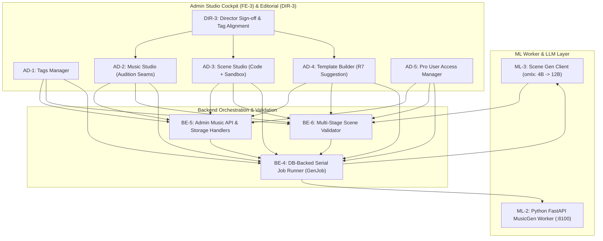
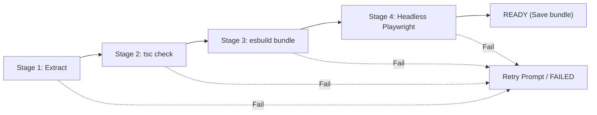
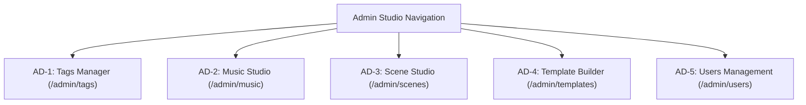
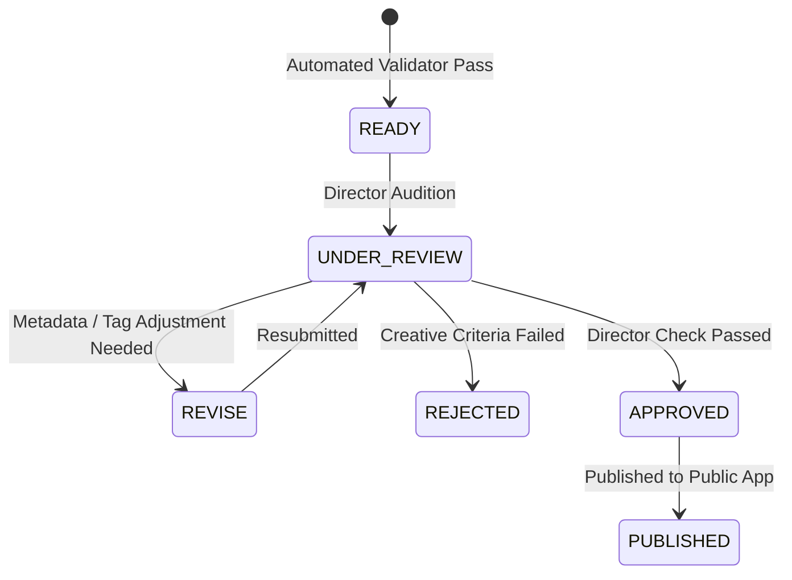

# Phase P2 User Requirements Document (URD): Content Pipelines

**Document Version:** 1.0.0  
**Date:** 2026-11-18  
**Author:** Business Analyst (BA)  
**Status:** Approved for P2 Implementation  
**Direct Predecessors:** [P2_TARGETS.md](file:///Users/daothang/Documents/Projects/TimeDrift/docs/phases/P2_TARGETS.md), [REQUIREMENTS.md](file:///Users/daothang/Documents/Projects/TimeDrift/docs/ba/REQUIREMENTS.md), [CREATIVE_BRIEF.md](file:///Users/daothang/Documents/Projects/TimeDrift/docs/creative/CREATIVE_BRIEF.md), [API.md](file:///Users/daothang/Documents/Projects/TimeDrift/docs/architecture/API.md), [DATA_MODEL.md](file:///Users/daothang/Documents/Projects/TimeDrift/docs/architecture/DATA_MODEL.md), [AUDIO_GUIDE.md](file:///Users/daothang/Documents/Projects/TimeDrift/docs/audio/AUDIO_GUIDE.md), [SCENE_GUIDE.md](file:///Users/daothang/Documents/Projects/TimeDrift/docs/scenes/SCENE_GUIDE.md)

---

## 1. Executive Summary & Objective

The objective of **Phase P2: Content Pipelines** is to construct TimeDrift's automated content generation, validation, and editorial curation infrastructure. At the conclusion of P2, the platform must possess the full capability to generate relaxing, seamless audio loops on local CPU hardware, synthesize and validate sandboxed line-art SVG animations via local LLMs, and provide an editorial studio for admins and the Creative Director to curate, audit, approve, and assemble publication-ready templates.

This URD sets forth the functional requirements, exact data contracts, error schemas, state transitions, business rule enforcements (Rules R7, R8, R10, R11, R12), and acceptance criteria for the seven primary work packages of P2:
- **`ML-2`:** Python FastAPI MusicGen CPU worker with automated equal-power crossfading, −16 LUFS loudness mastering, and Ogg Vorbis output.
- **`BE-4`:** DB-backed asynchronous Job Runner (`GenJob`) with serial per-kind queue locking, polling, crash recovery, and cancellation.
- **`BE-5`:** Admin Music API route handlers, storage management, and MusicGen client integration enforcing R10 and R12.
- **`ML-3`:** Scene generation client orchestrating `omlx` chat completions, structured prompt assembly, progressive fallback, and 2-retry self-correction loops.
- **`BE-6`:** Automated multi-stage Scene Validator enforcing sandbox isolation, TypeScript compilation, bundling, and headless Chromium execution.
- **`FE-3`:** Admin Studio Cockpit UI across screens AD-1 to AD-5 (Tags, Music Studio, Scene Studio, Template Builder with R7 Jaccard scoring, User Pro Management).
- **`DIR-3`:** Editorial curation workflow (Approve, Revise, Reject, tag matching verification $\ge 2$ shared tags) and Creative Director sign-off gates.

---

## 2. Business Rules & Governance Traceability (P2 Scope)

Phase P2 strictly enforces the following core business rules established in [REQUIREMENTS.md](file:///Users/daothang/Documents/Projects/TimeDrift/docs/ba/REQUIREMENTS.md) and [DATA_MODEL.md](file:///Users/daothang/Documents/Projects/TimeDrift/docs/architecture/DATA_MODEL.md):

| Rule ID | Rule Definition | P2 Architectural Implementation & Enforcement |
|---|---|---|
| **R7** | **Template Suggestion Score:** $\text{Jaccard}(\text{scene.tags}, \text{music.tags}) = \frac{|\text{scene.tags} \cap \text{music.tags}|}{|\text{scene.tags} \cup \text{music.tags}|}$. Sorted descending. Pairs with score $< 0.2$ hidden by default. | Enforced in `BE-5` / `FE-3` (`/api/admin/templates/suggest?sceneId=...`). Calculates Jaccard coefficient; filter threshold default 0.2 with toggleable override in UI. |
| **R8** | **Catalog Visibility & Template Integrity:** Users only see content with `published = true`. A template can only be published if its referenced `music` AND `scene` are both `published = true`. | Enforced in `BE-5` / `FE-3` template mutation endpoints. Attempting to set `Template.published = true` when either `Music.published == false` or `Scene.published == false` yields `400 VALIDATION` (`TEMPLATE_PARTS_NOT_PUBLISHED`). |
| **R10** | **Music Publish Prerequisite & Duration Constraint:** Music must have status `READY` to publish. Music duration must be strictly 30, 45, or 60 seconds. | Enforced in `BE-5` and `ML-2`. Zod schema rejects durations $\notin \{30, 45, 60\}$. Publishing route checks `Music.status === GenStatus.READY`; otherwise rejects with `400 VALIDATION` (`MUSIC_NOT_READY`). |
| **R11** | **Scene Validation Prerequisite:** Scenes must pass the full 4-stage validation pipeline (`READY`) to publish. If an admin edits the source code, status resets to `VALIDATING` and the validator runs again. | Enforced in `BE-6` and `FE-3`. Updating `Scene.sourcePath` triggers automated re-validation. Publishing route rejects non-READY scenes with `400 VALIDATION` (`SCENE_NOT_READY`). |
| **R12** | **Cascade Deletion & Unpublish Protection:** Deleting content used by a template or playlist is blocked; the API returns references. Unpublishing hides content; playlist references skip gracefully during runtime. | Enforced in Prisma schema (`onDelete: Restrict`) and API handlers. Deleting Music or Scene referenced by Template returns `409 CONFLICT_IN_USE` with list of dependent Template IDs/Names. |

---

## 3. Work Package Detailed Specifications



---

### 3.1. ML-2: Python MusicGen CPU Worker Functional Specification

#### 3.1.1. Service Architecture & Environment
- **Runtime:** Python 3.11 FastAPI microservice hosted on `http://127.0.0.1:8100` (`worker/music/`).
- **Engine:** Hugging Face `transformers` with `facebook/musicgen-small` model executing on PyTorch CPU (`torch.device("cpu")`, `torch.float32`).
- **Concurrency:** Single-worker execution queue. Only 1 audio generation runs at any time to prevent CPU starvation.

#### 3.1.2. API Endpoints
1. **Health Check:**
   - `GET /health`
   - Response: `200 OK`
   ```json
   {
     "status": "ok",
     "model_loaded": true,
     "device": "cpu",
     "version": "1.0.0"
   }
   ```
2. **Audio Generation:**
   - `POST /generate`
   - Headers: `Content-Type: application/json`
   - Request Body:
   ```json
   {
     "prompt": "soft solo piano, gentle rain mood, 65 bpm, warm reverb, sparse melody, no vocals, loopable, soft dynamics",
     "seconds": 30,
     "out_path": "/absolute/path/to/storage/audio/raw_job_123.ogg"
   }
   ```
   - Request Validation:
     - `seconds`: Must be an integer in `{30, 45, 60}` (enforcing R10).
     - `prompt`: String, non-empty, max 500 characters.
     - `out_path`: Valid writable absolute file path ending in `.ogg`.
   - Response (`200 OK`):
   ```json
   {
     "out_path": "/absolute/path/to/storage/audio/raw_job_123.ogg",
     "duration_sec": 30.0,
     "integrated_lufs": -16.02,
     "true_peak_dbtp": -1.05,
     "sample_rate": 32000,
     "channels": 1
   }
   ```
   - Error Response (`400 Bad Request` or `500 Internal Error`):
   ```json
   {
     "detail": "Generation failed: [Error Description]"
   }
   ```

#### 3.1.3. Audio Processing Pipeline & Algorithmic Steps
1. **Raw Generation:** Generate `target_seconds + 4.0` seconds of audio at model native rate (32 kHz) using generation parameters: `guidance_scale=3.0`, `temperature=1.0`, `top_k=250`.
2. **Seamless Loop Crossfading:**
   - Extract the trailing 4.0 seconds (tail) and leading 4.0 seconds (head).
   - Locate the nearest zero-crossing point within $\pm 50\text{ ms}$ of the seam boundary to prevent DC offset clicks.
   - Apply an **equal-power crossfade curve**:
     $$\text{gain}_{\text{head}}(t) = \sin\left(\frac{\pi}{2} \cdot \frac{t}{L}\right), \quad \text{gain}_{\text{tail}}(t) = \cos\left(\frac{\pi}{2} \cdot \frac{t}{L}\right) \quad \text{for } t \in [0, L], \, L = 4.0\text{s}$$
   - Overlap and add the windowed tail into the head, trimming the total audio length to exactly `seconds` (30.0, 45.0, or 60.0s).
3. **Loudness Normalization:**
   - Measure integrated loudness using `pyloudnorm.Meter` (BS.1770-4 filter).
   - Normalize target integrated loudness to **−16.0 LUFS** ($\pm 0.5\text{ LUFS}$).
   - Verify True Peak does not exceed **−1.0 dBTP**. Apply soft peak limiting if required.
4. **Encoding:**
   - Downmix to mono (if stereo) and output at 32 kHz sample rate.
   - Encode to Ogg Vorbis quality 5 (`-q:a 5`, $\approx 80\text{ kbps}$) via `soundfile` or `ffmpeg`.

#### 3.1.4. Pytest Test Suite Requirements
The worker must include comprehensive unit and integration tests under `worker/music/tests/`:
- `test_health`: Asserts `/health` responds with model status.
- `test_generation_contract`: Validates parameter constraints (rejects 20s or 90s, accepts 30s).
- `test_crossfade_equal_power`: Verifies RMS energy stability across the 4.0s crossfade boundary.
- `test_loudness_normalization`: Confirms output audio measures $-16.0 \pm 0.5$ LUFS and true peak $\le -1.0$ dBTP.
- `test_zero_crossing`: Validates seam boundary starts and ends at zero-crossing amplitude.

---

### 3.2. BE-4: DB-Backed Job Runner Functional Specification

#### 3.2.1. GenJob Data Entity Lifecycle
The job queue manages compute-heavy operations (MusicGen execution and LLM scene generation/validation) using the SQLite `GenJob` table.

```
       ┌───────────┐
       │  QUEUED   │ (Initial creation)
       └─────┬─────┘
             │ Picked up by runner
             ▼
       ┌───────────┐
       │  RUNNING  │ (Executing worker or LLM)
       └─────┬─────┘
             ├────────────────────────────────┐
             │ (Scene only: LLM generated)    │
             ▼                                │
       ┌───────────┐                          │
       │VALIDATING │ (Headless verification)  │
       └─────┬─────┘                          │
             │                                │
      ┌──────┴──────┐                  ┌──────┴──────┐
      │             │                  │             │
      ▼             ▼                  ▼             ▼
┌───────────┐ ┌───────────┐      ┌───────────┐ ┌───────────┐
│   READY   │ │  FAILED   │      │   READY   │ │  FAILED   │
└───────────┘ └───────────┘      └───────────┘ └───────────┘
```

#### 3.2.2. Queue Scheduling & Serial Concurrency Invariants
1. **Serial Worker Execution:** 
   - Music generation jobs (`kind = "music"`) must execute **strictly serially** (max 1 concurrent job).
   - Scene generation jobs (`kind = "scene"`) must execute **strictly serially** (max 1 concurrent job).
   - Enforced via atomic database locking or transaction flag: `UPDATE GenJob SET status = 'RUNNING' WHERE id = ... AND status = 'QUEUED'`.
2. **Crash Recovery & Orphan Detection:**
   - On server startup / boot: Any `GenJob` in `RUNNING` or `VALIDATING` status with `updatedAt < NOW() - 10 minutes` is flagged as orphaned.
   - Status transitions to `FAILED` with log: `Job aborted: runner restarted or timed out`.
3. **Job Cancellation:**
   - Admin can request cancellation for any job in `QUEUED` status (immediately deleted or set to `FAILED`).
   - If already `RUNNING`, the process cancellation token is tripped; worker process is signaled.
4. **Retry Budget:**
   - `attempts` counter increments on each retry.
   - Max attempts for scene generation is **3** (attempt 1–2 on default model, attempt 3 on fallback model).

---

### 3.3. BE-5: Music API Route Handlers & Integration Spec

#### 3.3.1. Route Handler Specifications

| Method | Path | Auth / Guard | Purpose & Invariant Rules |
|---|---|---|---|
| `POST` | `/api/admin/music` | `ADMIN` | Create a new music entity and enqueue generation job. |
| `POST` | `/api/admin/music/:id/regenerate` | `ADMIN` | Trigger new generation job with same or updated prompt. |
| `PATCH` | `/api/admin/music/:id` | `ADMIN` | Update metadata (names, tags) or toggle `published`. Enforces **R10**. |
| `DELETE` | `/api/admin/music/:id` | `ADMIN` | Delete music track. Enforces **R12** (blocked if used in template). |

#### 3.3.2. Request / Response Zod Schemas
1. **POST `/api/admin/music`:**
   ```ts
   export const CreateMusicSchema = z.object({
     name: z.string().min(1).max(100),
     type: z.enum([
       "lofi", "piano", "ambient", "acoustic", 
       "strings", "nature-ambient", "chillhop", "music-box"
     ]),
     tagIds: z.array(z.string().cuid()).min(1),
     prompt: z.string().min(10).max(500),
     seconds: z.union([z.literal(30), z.literal(45), z.literal(60)]) // R10
   });
   ```
   - Success Response (`201 Created`):
   ```json
   {
     "music": { "id": "cm...", "name": "Rainy Window", "status": "QUEUED" },
     "jobId": "cj..."
   }
   ```
2. **PATCH `/api/admin/music/:id` (Publish Enforcement):**
   ```ts
   export const UpdateMusicSchema = z.object({
     name: z.string().min(1).max(100).optional(),
     published: z.boolean().optional(),
     tagIds: z.array(z.string().cuid()).optional()
   });
   ```
   - **R10 Rule Guard:** If `payload.published === true`:
     ```ts
     if (music.status !== "READY") {
       return NextResponse.json(
         { error: { code: "VALIDATION", message: "Music must have status READY to publish (R10)" } },
         { status: 400 }
       );
     }
     ```
3. **DELETE `/api/admin/music/:id` (Cascade Protection):**
   - **R12 Rule Guard:**
     ```ts
     const dependentTemplates = await prisma.template.findMany({
       where: { musicId: params.id },
       select: { id: true, name: true }
     });
     if (dependentTemplates.length > 0) {
       return NextResponse.json(
         { 
           error: { 
             code: "CONFLICT_IN_USE", 
             message: "Cannot delete music track currently referenced by templates (R12)",
             references: dependentTemplates 
           } 
         },
         { status: 409 }
       );
     }
     ```

---

### 3.4. ML-3: Scene Generation Client Specification

#### 3.4.1. LLM Integration & Orchestration
- **Inference Server:** Local `omlx` OpenAI-compatible completion endpoint `POST http://10.1.123.123:8000/v1/chat/completions`.
- **Model Hierarchy:**
  - Attempt 1: Default `LLM_MODEL=Qwen3.5-4B-3D-Coder`
  - Attempt 2: Retry with error feedback on `LLM_MODEL=Qwen3.5-4B-3D-Coder`
  - Attempt 3: Final fallback to `LLM_FALLBACK_MODEL=gemma-4-12b-4bit`
- **Generation Parameters:** `temperature: 0.4`, `max_tokens: 6000`, `stream: false`.

#### 3.4.2. Prompt Assembly Architecture
1. **System Prompt (`src/server/prompts/scene.system.md`):**
   - Contains condensed line-art animation library API signatures (`ink.ts`, `gait.ts`, `motion.ts`, `daynight.ts`).
   - Declares the strict TypeScript module interface (`@timedrift/scene-api`):
     ```ts
     export default function mount(svg: SVGSVGElement, opts: SceneOpts): SceneHandle;
     ```
   - Embedded few-shot reference example (Seed Scene S1: Porch Lantern).
   - Invariant constraints: viewBox `0 0 1920 1080`, $\le 6$ animated figures, gait $\le 0.6$, deterministic Mulberry32 seed, continuous $\tau$ color binding.
2. **User Prompt Template:**
   ```
   Scene name: {name}
   Description: {description}
   Feeling tags: {tags}
   Admin notes: {prompt}
   Return ONLY one TypeScript code block implementing the contract.
   ```
3. **Retry Prompt Template (Self-Correction Loop):**
   ```
   Your previous TypeScript scene code failed validation with the following error:
   {validator_stage}: {error_message}

   Previous code:
   ```{previous_code}```

   Fix the issue, adhering strictly to the @timedrift/scene-api contract and library signatures.
   Return ONLY the complete updated TypeScript code block.
   ```

---

### 3.5. BE-6: Multi-Stage Scene Validator Functional Specification

Every scene produced by LLM generation or manually updated by an admin must pass all four automated gates in sequence:



#### 3.5.1. Validation Stages
1. **Stage 1: Source Extraction & Syntax Scan:**
   - Extracts the typescript code fenced block (` ```ts ... ``` `).
   - Security check: Scans for prohibited tokens (`fetch`, `eval`, `XMLHttpRequest`, `WebSocket`, `Worker`, `localStorage`, `document.cookie`). If detected, stage fails immediately.
2. **Stage 2: Typecheck (`tsc --noEmit`):**
   - Compiles extracted source code against `@timedrift/scene-api` and `vendor/line-art-animation/lib`.
   - Rejects with detailed compiler diagnostics on any type or missing import error.
3. **Stage 3: Bundler (`esbuild`):**
   - Bundles source code into a standalone ECMAScript module:
     ```sh
     esbuild --bundle --format=esm --minify --target=es2022
     ```
   - Bundles internal vendor modules; resolves `@timedrift/scene-api` contract. Produces minified JavaScript.
4. **Stage 4: Headless Chromium Sandbox Verification (`Playwright`):**
   - Launches headless Chromium instance.
   - Navigates to `public/scene-host.html?bundle=...` under strict sandbox (`sandbox="allow-scripts"`).
   - Executes for **3.0 seconds** of simulated animation time.
   - **Pass Criteria:**
     1. Zero uncaught exceptions or console errors (`page.on('pageerror')`).
     2. SVG element contains $\ge 20$ rendered DOM child nodes (prevents blank/collapsed scenes).
     3. Pixel differential: Capture screenshot at $t = 0.5\text{s}$ and $t = 2.0\text{s}$; image diff must be $> 0$ (verifies active kinematic animation).
     4. CPU benchmark: JS thread execution time $< 900\text{ ms}$ over 3.0s run ($< 30\%$ single-core threshold).

---

### 3.6. FE-3: Admin Studio Cockpit UI Specification

The Admin Studio provides five dedicated management screens (`/admin/...`) accessible strictly to users with role `ADMIN`:



#### 3.6.1. AD-1: Tags Manager (`/admin/tags`)
- **Table / List View:** Displays all tags with `slug`, English Name (`nameEn`), Vietnamese Name (`nameVi`), and usage counts (Music count, Scene count, Template count).
- **Create / Edit Drawer:**
  - Slug input: validated as lowercase kebab-case (`^[a-z0-9]+(-[a-z0-9]+)*$`).
  - Bilingual fields: `nameEn` and `nameVi` both required.
- **Delete Confirmation Dialog:**
  - If usage count $> 0$, displays warning badge: *"This tag is currently attached to X items. Deleting it will detach it from all items."*
  - Requires explicit confirmation button: *"Delete and Detach"*.

#### 3.6.2. AD-2: Music Studio (`/admin/music`)
- **Generation Creation Form:**
  - Inputs: Name, Track Type (select dropdown from 8 allowed types), Emotion Tag multiselect, Length radio buttons (30s, 45s, 60s), Creative Prompt textarea.
  - "Generate Loop" button enqueues job and shows live polling status card (`QUEUED` $\to$ `RUNNING` $\to$ `READY`).
- **Loop Seam Audition Player:**
  - HTML5 Web Audio audition player with **Continuous 3-Loop Playback Mode**.
  - **Loop Seam Inspector:** Quick-scrub button that jumps audio playback directly to $-5\text{s}$ before the loop boundary, playing across the seam into $+5\text{s}$.
  - Aesthetic Telemetry Card: Displays measured Integrated LUFS (−16 LUFS), True Peak dBTP, Sample Rate, and active tags.
- **Actions Bar:**
  - "Regenerate" (re-opens form with prompt pre-filled).
  - "Publish / Unpublish" toggle (enforcing **R10**).
  - "Delete" button (enforcing **R12** with dependency modal).

#### 3.6.3. AD-3: Scene Studio (`/admin/scenes`)
- **Generation Form:** Name, Description, Tags, Prompt notes.
- **Dual-Pane Curation Cockpit:**
  - **Left Pane (Code Editor & Job Diagnostics):**
    - Read/write TypeScript code editor (Monaco or CodeMirror) displaying generated `source.ts`.
    - Live Job Progress bar indicating current attempt (Attempt 1/3, Attempt 2/3, Fallback Attempt 3/3) and active model name.
    - Diagnostics console displaying TypeScript compilation logs or Chromium validation error stacks.
    - "Save & Rebuild" button: Updates source and triggers re-validation pipeline (**R11**).
  - **Right Pane (Live Sandboxed Preview):**
    - Sandboxed iframe embedding `public/scene-host.html`.
    - **Time Scrubber ($\tau$ Slider):** Real-time interactive slider from $0.0$ to $1.0$ dispatching `setTau(value)` to test daylight transitions, dusk inks, and nighttime warm lantern glows.
    - **Speed Multiplier:** Select buttons (`0.25x`, `1.0x`, `2.0x`, `10.0x`) for rapid kinematic trajectory inspection.
    - **Mobile 9:16 Center Safe Zone Guide:** Overlay toggle rendering a translucent 9:16 grid ($x \in [660, 1260]$) to confirm visual subjects remain in mobile focus.

#### 3.6.4. AD-4: Template Builder (`/admin/templates`)
- **Template Assembly Interface:**
  - Scene Selector: Dropdown or visual card picker of published scenes.
  - **Intelligent Music Suggestion Engine (R7):**
    - Selecting a scene queries `/api/admin/templates/suggest?sceneId=...`.
    - Suggests published music tracks sorted descending by **Jaccard similarity score**:
      $$\text{Score} = \frac{|\text{scene.tags} \cap \text{music.tags}|}{|\text{scene.tags} \cup \text{music.tags}|}$$
    - Displays similarity badge (e.g. `Score: 0.67 (2 shared tags)`).
    - Pairs with score $< 0.2$ are hidden by default with a checkbox: *"Show low-similarity tracks (< 0.2)"*.
  - Template Metadata: Title, Description, and Tags (automatically pre-populated with the intersection $\text{scene.tags} \cap \text{music.tags}$).
  - Live Unified Audition: Plays selected scene and music simultaneously in sync.
  - **Publish Guard (R8):** "Publish Template" button disabled if either Scene or Music is unpublished.

#### 3.6.5. AD-5: Users Management (`/admin/users`)
- User table with search/filter: Email, Name, Role (`USER` / `ADMIN`), Pro Status badge (`FREE` / `PRO`).
- "Edit Pro Access" Dialog:
  - Toggle `isPro` status.
  - Set `proUntil` expiration date (or toggle indefinite / lifetime access).
  - Instant update reflecting **R9** evaluation.

---

### 3.7. DIR-3: Editorial Workflow & Sign-Off Specification

The Creative Director editorial workflow acts as the final quality control gate before any template or individual asset is published.



#### 3.7.1. Editorial Review Actions
1. **APPROVE:**
   - Approves asset for public broadcast.
   - Enforces **Bilingual Title Validation**: Both English and Vietnamese titles must be non-empty and poetically verified.
   - For Templates: Validates $\ge 2$ shared tags between scene and music (or explicit artistic override justification).
2. **REVISE:**
   - Allows curator to adjust metadata (refine translated titles, add/remove tags) without re-running generation.
3. **REJECT:**
   - Marks asset as rejected and archives artifacts.
   - Requires single-click rejection reason categorization:
     - Audio: `Percussion too loud/harsh`, `Audible seam loop click`, `Vocal-like artifact`, `Tempo too fast (>85 BPM)`.
     - Scene: `Figure count exceeded (>6)`, `Erratic/fast motion (>0.5Hz)`, `Off-center composition (9:16 safe zone violation)`, `Diurnal palette clipping`.

---

## 4. Verification Scenarios & Test Matrix (P2-QA-01 to P2-QA-15)

| Test ID | Area | Scenario | Acceptance Criteria & Expected Outcome |
|---|---|---|---|
| **P2-QA-01** | MusicGen Worker | Verify `/health` endpoint | Worker responds `200 OK` with `status: "ok"`, `device: "cpu"`. |
| **P2-QA-02** | MusicGen Worker | Audio length constraint (R10) | Worker rejects requests with `seconds=20` or `seconds=90` with `400 Bad Request`. Accepts `30`, `45`, `60`. |
| **P2-QA-03** | MusicGen Audio | Equal-power loop crossfade | Output audio has seamless loop. Pytest RMS test confirms energy delta $< 0.8\text{ dB}$ across seam; zero-crossing boundary aligned. |
| **P2-QA-04** | MusicGen Audio | Loudness normalization | Audio file integrated loudness measures $-16.0 \pm 0.5\text{ LUFS}$ and true peak $\le -1.0\text{ dBTP}$ via `pyloudnorm`. |
| **P2-QA-05** | Job Runner | Serial execution locking | When 2 music jobs are submitted simultaneously, Job 1 enters `RUNNING`, Job 2 remains `QUEUED` until Job 1 finishes. |
| **P2-QA-06** | Job Runner | Crash & orphan recovery | Simulated worker kill leaves job in `RUNNING`. On server restart, stale job transitions to `FAILED` with diagnostic recovery log. |
| **P2-QA-07** | Music API | Publish gating (R10) | Calling `PATCH /api/admin/music/:id` with `{ published: true }` fails with `400 VALIDATION` if `status !== "READY"`. |
| **P2-QA-08** | Music API | Deletion cascade block (R12) | Attempting `DELETE /api/admin/music/:id` on a track assigned to a Template returns `409 CONFLICT_IN_USE` listing dependent templates. |
| **P2-QA-09** | Scene Gen | LLM generation retry loop | When attempt 1 produces invalid TS syntax, retry prompt is assembled with error diagnostic; attempt 2 successfully compiles. |
| **P2-QA-10** | Scene Gen | Fallback model switch | If attempts 1 & 2 fail on `Qwen3.5-4B-3D-Coder`, attempt 3 automatically switches to `gemma-4-12b-4bit`. |
| **P2-QA-11** | Scene Validator | Security token block | Scene code containing `window.fetch(...)` or `eval(...)` fails Stage 1 immediately; does not proceed to tsc or esbuild. |
| **P2-QA-12** | Scene Validator | Headless animation check | Static scene with 0 pixel motion over 3.0s fails Stage 4 Playwright render check (`PIXEL_DIFF_ZERO`). |
| **P2-QA-13** | Admin Studio | R7 Jaccard template score | Template builder queries `/api/admin/templates/suggest?sceneId=...`. Scores accurately reflect tag intersection/union; tracks $< 0.2$ hidden by default. |
| **P2-QA-14** | Admin Studio | Template publish guard (R8) | Attempting to publish a template whose scene or music is unpublished returns `400 VALIDATION` (`TEMPLATE_PARTS_NOT_PUBLISHED`). |
| **P2-QA-15** | Director Review | Bilingual title requirement | Director approval action blocked if either English or Vietnamese title field is blank. |

---

## 5. Director Sign-Off Acceptance Checklist

Before any Phase P2 generated asset or template is approved for production release, the following checklist must be signed off by the Creative Director:

- [ ] **Aesthetic Mood:** Captures *"ink on warm paper, breathing slowly"*; conveys calm, stillness, and organic flow.
- [ ] **Figure & Motion Restraint:** Maximum 6 animated figures; unhurried gait ($\le 0.6$ speed); kinematics $\le 0.5\text{ Hz}$.
- [ ] **Mobile Safe Zone:** Essential subjects centered within 9:16 crop ($x \in [660, 1260]$); no crucial elements cut off on mobile.
- [ ] **Auditory Tranquility:** No jarring percussive transients, brass, or human vocals; integrated loudness strictly $-16\text{ LUFS}$.
- [ ] **Inaudible Seam:** Three consecutive loop cycles audited on headphones with zero audible seam, pop, or phase cancellation.
- [ ] **Diurnal Grace:** Continuous $\tau \in [0, 1]$ scrubber reveals smooth palette shifts and warm nocturnal glowing accents without flashes.
- [ ] **Tag Pairing Integrity:** Template shares $\ge 2$ emotion tags between scene and music with mood alignment.
- [ ] **Bilingual Poetry:** Names and descriptions in English and Vietnamese are evocative, culturally nuanced, and grammatically complete.
