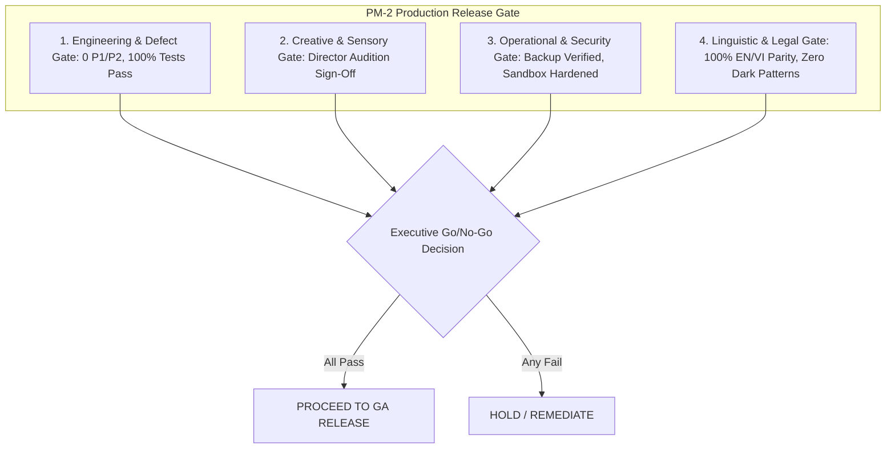

# User Requirements Document (URD) & Acceptance Criteria: Phase P4 Hardening & Release

**Document Version:** 1.0.0  
**Date:** 2026-11-18  
**Author:** Business Analyst (BA)  
**Status:** Approved for Implementation  
**Target Phase:** P4 (Hardening & Release)  
**Related Documents:** [REQUIREMENTS.md](file:///Users/daothang/Documents/Projects/TimeDrift/docs/ba/REQUIREMENTS.md), [P4_TARGETS.md](file:///Users/daothang/Documents/Projects/TimeDrift/docs/phases/P4_TARGETS.md), [TEST_PLAN.md](file:///Users/daothang/Documents/Projects/TimeDrift/docs/qa/TEST_PLAN.md), [SETUP.md](file:///Users/daothang/Documents/Projects/TimeDrift/docs/ops/SETUP.md), [CREATIVE_BRIEF.md](file:///Users/daothang/Documents/Projects/TimeDrift/docs/creative/CREATIVE_BRIEF.md), [DECISIONS.md](file:///Users/daothang/Documents/Projects/TimeDrift/docs/DECISIONS.md)

---

## 1. Executive Summary & Objective

The objective of **Phase P4: Hardening & Release** is to transition TimeDrift from feature-complete status (P3) to an industrial-grade, certified production release. P4 guarantees zero aesthetic compromises, zero acoustic glitches, rock-solid security, verifiable accessibility, and resilient production operations.

This document establishes the detailed functional and technical requirements for:
1. **QA-2: Automated End-to-End Test Suite:** Complete Playwright test specifications covering end-to-end scenarios **E1 through E10**, asserting business rules **R1–R12**, API error handling, and cross-browser consistency.
2. **QA-3: Device Matrix, Visual Composition & Accessibility Audit:** Cross-platform verification across desktop and mobile browsers, WCAG 2.2 AA compliance, 9:16 safe-zone framing, and screen reader / keyboard navigation.
3. **OPS-2: Production Containerization & Packaging:** Multi-stage Docker builds for the Next.js frontend/server, Python FastAPI MusicGen worker container, and root `docker-compose.yml` with persistent volumes, network isolation, and health checks.
4. **OPS-3: Backup Automation, Restore Drills & Health Telemetry:** Production SQLite atomic backup (`VACUUM INTO`), automated recovery verification, and deep health check route (`/api/health`) reporting system, database, and storage metrics.
5. **PM-2: Production Readiness Gate & Launch Governance:** Zero-defect threshold enforcement (0 P1/P2), Creative Director sign-off on mood and content, and the executive Go/No-Go release matrix.

---

## 2. Business Rules Baseline (P4 Enforcement & Traceability)

| Rule ID | Rule Statement Summary | Guest / Free Bounds | Pro Bounds | P4 Verification Mechanism & Target |
|---|---|---|---|---|
| **R1** | Free Run Duration | 3–15 min (presets: 3, 5, 10, 15; step: 1 min). Default: 15 min. | N/A | **E1 & E2:** Playwright asserts duration bounds, API rejection (400) on out-of-range requests. |
| **R2** | Run Completion & Transition | At timer expiration: 10s logarithmic audio fade-out; scene slows and pauses; End screen appears with Replay, Random, Back. Immediate restart allowed. No daily or cumulative session caps. | Identical behavior for Free and Pro users. | **E1:** Mock clock advances to expiration; verify 10s fade taper, End screen visibility, and immediate Replay trigger. |
| **R3** | Pro Run Duration | 3–15 min | 3–720 min (presets: 30, 60, 120, 240, 480, 720; step: 1 min). Default: 60 min. | **E4:** Pro session initialized for 720 min passes; 721 min returns 400. |
| **R4** | Pro-Gated Routes | Access blocked; triggers non-coercive upsell sheet. Zero data leakage. | Full access to `/custom` and `/playlists`. | **E3:** Guest navigation to `/custom` and `/playlists` opens Pro Upsell modal; API returns 403 `PRO_REQUIRED`. |
| **R5** | Playlist Limits & Cap | N/A (Pro only) | 1–50 items. Each item 3–720 min. Total planned duration $\le 720$ min. | **E5:** Save button disabled and API returns 400 if item count > 50 or total minutes > 720. |
| **R6** | Deterministic Random Selection | Selects a published template at random. Fallback 1: random published scene + published music sharing $\ge 1$ tag. Fallback 2: random published scene + any published music. Never repeats immediate prior item (`excludeId`). | Identical algorithm for Free and Pro. | **E6:** 20 consecutive random executions verify published-only filter and non-consecutive uniqueness. |
| **R7** | Template Pairing Score | Jaccard tag similarity index. | Same | Unit/API verification in `rules.test.ts`. |
| **R8** | Publication Dependency | Users see only `published = true`. Template can only be published if its scene and music are both published. | Same | **E7:** Admin attempts to publish template linked to unpublished scene; API rejects with 400/409; UI blocks publication toggle. |
| **R9** | Pro Session Continuity | Evaluated at session start: `isPro && (proUntil == null \|\| proUntil > now)`. Mid-session expiry allows active session to complete planned duration. Subsequent session reverts to Free limits. | Active session uninterrupted; subsequent session clamped to 15m. | **E10:** Active Pro session continues uninterrupted when timestamp passes `proUntil`; new session enforces Free 15 min limit. |
| **R10** | Music Duration & Ready Status | Music duration 30, 45, or 60s. Status must be READY to publish. | Same | API & worker unit verification; QA-2 seed setup. |
| **R11** | Scene Sandbox & Validation | Scene must pass compilation, bundling, and headless render check to publish. Untrusted code runs in sandboxed iframe without `allow-same-origin`. | Same | QA-3 visual check and CSP header audit. |
| **R12** | Cascade Deletion & Skip Protection | Deletion of music or scene used by a template is blocked (409 `CONFLICT_IN_USE`). If content in a playlist is unpublished, the player skips that item. | Same | **E8:** Admin deletion of music used in template returns 409 and lists dependent template. |

---

## 3. Work Package Specifications

### 3.1. QA-2: End-to-End Playwright Test Suite Specifications

The E2E test suite must execute deterministically in headless Chromium, Firefox, and WebKit under CI and local development. Clock virtualization (`page.clock`) is utilized to simulate extended timer durations (up to 720 minutes) in milliseconds.

#### 3.1.1. E1: Guest Playback, Timer Expiration & Replay Flow
- **User Role:** Unauthenticated Guest.
- **Initial State:** User navigates to `/[locale]`. Seed contains published template `T1` ("Midnight Rain", duration default 15m).
- **Execution Steps:**
  1. Click template card `T1`.
  2. Duration Sheet opens. Select preset **"3 min"**.
  3. Click **"Begin Journey"**.
  4. Assert navigation to `/[locale]/play?templateId={id}&duration=3`.
  5. Assert initial UI: scene iframe loaded, audio status `PLAYING`, remaining time displays `03:00`.
  6. Advance system clock using `page.clock.fastForward("02:50")`. Assert timer displays `00:10`.
  7. Fast-forward another `10s` (total 3:00 reached).
  8. Assert audio gain initiates 10.0-second logarithmic fade-out (R2).
  9. Assert scene host receives `pause` message.
  10. Assert End screen modal displays with three buttons: **Replay**, **Random Drift**, **Home**.
  11. Click **Replay**.
- **Expected Results:**
  - Session seamlessly restarts at `03:00` without page reload or auth prompt.
  - Scene resumes animation; audio ramps up over 3.0-second fade-in.

#### 3.1.2. E2: Guest Cap & Pro Upsell Enforcement
- **User Role:** Unauthenticated Guest.
- **Execution Steps:**
  1. Open Duration Sheet for any template.
  2. Observe locked Pro presets: `30 min`, `60 min`, `120 min`, `240 min`, `480 min`, `720 min`.
  3. Attempt to click **"30 min 🔒"**.
  4. Assert Pro Upsell modal surfaces with headline *"Deepen Your Sanctuary"* (no page navigation).
  5. Close upsell modal via `Esc` or "Maybe later".
  6. Attempt direct HTTP API request: `POST /api/sessions` with payload `{"templateId": "...", "minutes": 30}` without session token.
- **Expected Results:**
  - Client UI prevents setting duration > 15m.
  - Server returns HTTP status `403 FORBIDDEN` with JSON error code `PRO_REQUIRED` (R1, R3, R4).

#### 3.1.3. E3: Pro Route Gating & Upsell Sheet
- **User Role:** Unauthenticated Guest.
- **Execution Steps:**
  1. Navigate directly to `/[locale]/custom`.
  2. Assert browser redirects or renders Pro Upsell view with 0 leaked music/scene assets.
  3. Navigate directly to `/[locale]/playlists`.
  4. Assert Pro Upsell view renders; playlist collection data is empty.
  5. Execute direct API calls: `GET /api/custom/options` and `GET /api/playlists`.
- **Expected Results:**
  - API responses return `403 FORBIDDEN` with body `{"error": "PRO_REQUIRED"}`.
  - UI remains tranquil, free of error toast crashes, displaying the dignified Pro value proposition.

#### 3.1.4. E4: Pro Extended Session (720 Minutes) & Upper Bound
- **User Role:** Authenticated Pro User (`user_pro@example.com`).
- **Execution Steps:**
  1. Navigate to template `T1` Duration Sheet.
  2. Assert presets up to `720 min` are unlocked.
  3. Select `720 min` preset.
  4. Submit session creation.
  5. Assert player mounts with timer displaying `12:00:00`.
  6. Execute malicious/fuzzed API request: `POST /api/sessions` with `{"templateId": "...", "minutes": 721}` using valid Pro session cookie.
- **Expected Results:**
  - 720-minute session initializes successfully.
  - 721-minute request rejected with HTTP `400 BAD_REQUEST: DURATION_EXCEEDED_MAX` (R3, R5).

#### 3.1.5. E5: Playlist CRUD, Item Limits & 720-Minute Accumulator Cap
- **User Role:** Authenticated Pro User.
- **Execution Steps:**
  1. Navigate to `/[locale]/playlists` and click **"Create Playlist"**.
  2. Add Item 1: Template A (duration: 360 min). Running total displays `360 / 720 min`.
  3. Add Item 2: Template B (duration: 360 min). Running total displays `720 / 720 min`.
  4. Save button is active. Click **"Save Playlist"** $\to$ Playlist created.
  5. Edit playlist: attempt to add Item 3 (duration: 15 min, pushing total to 735 min).
  6. Assert UI warning: *"Playlist total exceeds 720-minute sanctuary limit"* and **Save** button is disabled.
  7. Attempt direct API request: `PUT /api/playlists/{id}` with 51 items or total 721 min.
- **Expected Results:**
  - Client UI blocks saving when total > 720 min.
  - API returns HTTP `400 BAD_REQUEST: PLAYLIST_LIMIT_EXCEEDED` (R5).

#### 3.1.6. E6: Random Drift Determinism & Non-Consecutive Selection
- **User Role:** Guest / Pro.
- **Initial State:** 5 published templates (`T1` through `T5`) seeded in database.
- **Execution Steps:**
  1. Click **"Drift Randomly"** from Home (`/[locale]`).
  2. Capture resolved template ID (e.g., `T2`).
  3. From the active player or End screen, click **"Drift Randomly ⚄"** again.
  4. Repeat step 3 for **20 consecutive iterations**, capturing the sequence of template IDs.
- **Expected Results:**
  - For every index $i \in [1, 20]$, $\text{templateId}_{i} \neq \text{templateId}_{i-1}$ (R6).
  - Every selected template has `published = true`.
  - Fallback logic (scene + music tag intersection) executes gracefully if template catalog is emptied.

#### 3.1.7. E7: Template Publication Dependency (R8)
- **User Role:** Authenticated Admin (`admin@example.com`).
- **Initial State:** Scene `S_UNPUB` (`published = false`), Music `M_PUB` (`published = true`).
- **Execution Steps:**
  1. Navigate to Admin Templates page (`/[locale]/admin/templates`).
  2. Create template `T_NEW` pairing `S_UNPUB` and `M_PUB`.
  3. Attempt to toggle `published` status to `true` in UI.
  4. Assert publication toggle is disabled with tooltip: *"Scene must be published before template can be published"*.
  5. Send direct API request: `PATCH /api/admin/templates/{id}` with `{"published": true}`.
- **Expected Results:**
  - API returns HTTP `400 BAD_REQUEST: UNPUBLISHED_DEPENDENCY` citing `sceneId` (R8).
  - Template remains unpublished.

#### 3.1.8. E8: Cascade Deletion Protection (R12)
- **User Role:** Authenticated Admin.
- **Initial State:** Template `T_ACTIVE` uses Music `M_ACTIVE`.
- **Execution Steps:**
  1. Navigate to Admin Music library (`/[locale]/admin/music`).
  2. Locate `M_ACTIVE` and click **"Delete"**.
  3. Assert confirmation dialog surfaces with blocking error: *"Cannot delete track: currently used by template 'Midnight Rain'"*.
  4. Send direct API request: `DELETE /api/admin/music/{id}`.
- **Expected Results:**
  - API returns HTTP `409 CONFLICT: CONFLICT_IN_USE` listing dependent entities (R12).
  - Music track remains intact in storage and database.

#### 3.1.9. E9: Bilingual Locale Switching & Cookie Persistence
- **User Role:** Any user.
- **Execution Steps:**
  1. Navigate to `/en`. Verify all UI strings match English keys in `en.json`.
  2. Click language switcher and select **"Tiếng Việt"**.
  3. Assert URL updates to `/vi`.
  4. Assert all visible copy (navigation, hero, duration sheet, player controls, tooltips) immediately updates to Vietnamese strings in `vi.json` with zero missing keys or English fallback leaks.
  5. Reload the browser window (`page.reload()`).
  6. Assert page renders in `/vi` and cookie `NEXT_LOCALE=vi` is preserved.
- **Expected Results:**
  - 100% string localization parity between EN and VI.
  - Zero hydration mismatch errors in browser console.

#### 3.1.10. E10: Pro Mid-Session Expiration Continuity (R9)
- **User Role:** Authenticated Pro User whose subscription expires in 5 minutes (`proUntil = now + 5 min`).
- **Execution Steps:**
  1. User starts a 60-minute session at $T_0$.
  2. Advance system clock to $T_0 + 6\text{ min}$ (Pro status is now expired in database).
  3. Assert active playback is **not interrupted**: audio continues, scene animates, remaining time shows `54:00`.
  4. Advance clock to $T_0 + 60\text{ min}$. Session completes, 10s fade-out occurs, End screen renders.
  5. User clicks **"Replay"** or attempts to start a new session with duration > 15 min.
- **Expected Results:**
  - Active session ran to full 60-minute conclusion without interruption (R9).
  - New session request evaluates updated Pro status (`isPro = false` or expired) and enforces Free limits (clamp to 15 min or prompt Pro upsell).

---

### 3.2. QA-3: Device Matrix, Visual Composition & Accessibility Audit Specifications

#### 3.2.1. Certified Device & Browser Test Matrix

Testing must verify layout, canvas rendering, audio stability, and touch interaction across 5 core profiles:

| Profile | Platform / OS | Browser / Engine | Resolution | Orientation | Key Audit Focus |
|---|---|---|---|---|---|
| **D-1** | macOS 14+ | Safari 17+ (WebKit) | 1920×1080, 2560×1440 | Landscape | WebKit audio autoplay policy, SVG filter acceleration, Fraunces serif optical kerning. |
| **D-2** | Windows 11 | Chrome 120+ (Blink) | 1920×1080, 1366×768 | Landscape | 60fps SVG frame rate stability, keyboard focus outlines, high-contrast mode. |
| **D-3** | Ubuntu / Linux | Firefox ESR (Gecko) | 1920×1080 | Landscape | Web Audio API gain node logarithmic ramping, iframe postMessage event timing. |
| **D-4** | iOS 17+ | Mobile Safari (WebKit) | 393×852 (iPhone 15) | Portrait | **9:16 Center-Third Crop**, lock-screen playback controls (MediaSession API), silent switch bypass. |
| **D-5** | Android 14+ | Mobile Chrome (Blink) | 412×915 (Pixel 8) | Portrait | Screen Wake Lock API stability, touch ripple latency, back-button hardware handling. |

#### 3.2.2. Visual Composition & Center-Third Safe Zone Verification
- **16:9 ViewBox Standard:** Scenes render on a native $1920 \times 1080$ virtual coordinate space with `preserveAspectRatio="xMidYMid slice"`.
- **9:16 Mobile Center-Third Safe Zone:**
  - Viewport: $393 \times 852$.
  - All primary interactive elements and animated subjects (figures, lanterns, tea sets, sleeping animals) must reside within the coordinate range $X \in [640, 1280]$.
  - Verification: Overlay automated bounding box checks on automated Playwright screenshot captures. Zero figures may be clipped or bisected across mobile viewports.
- **Zero Layout Shift (CLS):** `CLS = 0.000` measured across all route transitions, player drawer toggles, and modal openings.

#### 3.2.3. WCAG 2.2 Level AA Accessibility Specifications
- **Contrast Ratios:**
  - *Day Mode (Sumi Ink on Washi Paper):* `#2B2A28` on `#F4EFE6` yields ratio $\mathbf{12.3:1}$ (exceeds $4.5:1$ threshold).
  - *Night Mode (Parchment on Sumi Wash):* `#EDE9DF` on `#161822` yields ratio $\mathbf{13.4:1}$.
  - *Focus Rings:* Distinct $3.0:1$ warm ochre (`#C28B38` / `#F2C46D`) non-destructive outline visible exclusively on `:focus-visible`.
- **Keyboard Traversal:**
  - Complete operational parity: 100% of user flows (discovery, preset selection, player controls, playlist management) navigable using `Tab`, `Shift+Tab`, `Space`, `Enter`, and `Esc`.
  - Trap management: Modals (Duration Sheet, Pro Upsell, Settings) trap focus within active container while open; restore focus to triggering element upon dismissal.
- **Screen Reader Fluidity (ARIA Standards):**
  - Live timer announcements: Playback timer countdown must **not** spam screen readers every second. The remaining time is exposed via `aria-label="Time remaining: X minutes"` updated on user inquiry or at milestone intervals (halfway, 1 min remaining, 10s fade).
  - Scene iframe host marked with `role="img"` and descriptive `aria-label` localized in EN/VI (e.g., *"Animated line-art illustration of rain falling on a quiet wooden porch"*).
  - Audio status: Play/pause button maintains dynamic `aria-label` ("Pause session" / "Resume session").
- **Reduced Motion (`prefers-reduced-motion: reduce`):**
  - When OS flag is detected, UI transition animations collapse to gentle 150ms opacity fades.
  - Scene host receives `SET_REDUCED_MOTION: true` postMessage, throttling SVG animation velocity to $0.25\times$ or transitioning to static contemplative breathing states without abrupt cuts.

---

### 3.3. OPS-2: Docker Production Packaging Specifications

Production containerization must produce minimal, secure, reproducible container images orchestrated via Docker Compose.

#### 3.3.1. Next.js Web Application Multi-Stage Dockerfile (`Dockerfile.web`)
- **Stage 1: Dependencies (`deps`):**
  - Base: `node:22-alpine`.
  - Install dependencies using `npm ci --omit=dev` for production dependencies, with devDependencies cached for build.
- **Stage 2: Builder (`builder`):**
  - Execute `prisma generate`.
  - Run Next.js production build (`npm run build`) with standalone output mode enabled (`output: 'standalone'` in `next.config.ts`).
  - Copy static assets (`public/`, `.next/static/`).
- **Stage 3: Runner (`runner`):**
  - Base: `node:22-alpine`.
  - Security hardening: Run as unprivileged user `nodejs:nodejs` (UID/GID 1001).
  - Install runtime dependencies: `chromium` and fonts required for headless scene validation (BE-6).
  - Expose port `3000`.
  - Health check: `curl -f http://localhost:3000/api/health || exit 1`.

#### 3.3.2. Python MusicGen Worker Dockerfile (`Dockerfile.worker`)
- **Base Image:** `python:3.11-slim`.
- **System Dependencies:** `ffmpeg`, `libsndfile1`, `curl`.
- **Python Setup:**
  - Install PyTorch CPU wheels (`torch`, `torchaudio` from `https://download.pytorch.org/whl/cpu`).
  - Install `transformers`, `fastapi`, `uvicorn`, `scipy`.
  - Pre-download MusicGen-small model weights into `/models/musicgen-small` during container build to ensure air-gapped zero-network startup.
- **Execution:**
  - Run as unprivileged user `worker:worker`.
  - Command: `uvicorn main:app --host 0.0.0.0 --port 8100 --workers 1`.
  - Health check: `curl -f http://localhost:8100/health || exit 1`.

#### 3.3.3. Orchestration Specification (`docker-compose.yml`)
- **Services:**
  1. `web`: Next.js web application on port `3000`.
     - Depends on `worker` (condition: `service_healthy`).
     - Volumes:
       - `timedrift_data:/app/data` (holds `timedrift.db`).
       - `timedrift_storage:/app/storage` (holds audio tracks and scene bundles).
  2. `worker`: Python FastAPI MusicGen service on internal port `8100`.
     - Volumes:
       - `timedrift_storage:/app/storage` (shares storage directory for audio rendering).
       - `model_cache:/models` (persistent model weights).
  3. `proxy` (Optional/Production): Nginx or Caddy reverse proxy providing TLS termination, HTTP/2, and gzip/brotli compression.
- **Volume Isolation:** Named volumes ensure SQLite database and audio files persist across container redeployments and host reboots.

---

### 3.4. OPS-3: Backup Automation, Restore Drills & Health Telemetry

#### 3.4.1. SQLite Atomic Backup Automation
- **Mechanism:** Standard file copies of active SQLite databases risk corruption if executed during an open write transaction. The backup pipeline must invoke SQLite's online backup API via:
  ```bash
  sqlite3 /app/data/timedrift.db "VACUUM INTO '/backups/db/timedrift-$(date +%Y%m%d_%H%M%S).db';"
  ```
- **Frequency:** Hourly cron execution inside the production container or host environment.
- **Storage Sync:** Synchronize `/app/storage` (audio files, scene artifacts) using `rsync -av --delete` or object storage sync.
- **Retention Policy:**
  - Hourly snapshots: Retained for 24 hours.
  - Daily snapshots: Retained for 7 days.
  - Weekly snapshots: Retained for 4 weeks.
  - Automated pruning script removes archives exceeding retention limits.

#### 3.4.2. Recovery Verification & Restore Drill
- **Restore Verification Script:** An automated sanity test script (`scripts/ops/verify-restore.sh`):
  1. Spawns an isolated ephemeral SQLite instance with the latest snapshot.
  2. Executes integrity check: `PRAGMA integrity_check;` (must return `ok`).
  3. Validates row counts across critical tables: `User`, `Scene`, `Music`, `Template`.
  4. Confirms that corresponding `.ogg` audio files referenced in `Music.storageKey` exist on disk.
  5. Emits exit code `0` on verified success, or alerts on failure.

#### 3.4.3. Health Telemetry Endpoint (`/api/health`)
- **Route:** `GET /api/health` (unauthenticated, lightweight probe for Docker/K8s/monitoring).
- **Checks Executed:**
  1. **Database Probe:** Executes `SELECT 1` against SQLite via Prisma. Latency must be $< 50\text{ms}$.
  2. **Storage Probe:** Verifies write/read capability in `/storage` directory.
  3. **Worker Connectivity:** HTTP GET to `http://worker:8100/health` with a 2.0s timeout.
  4. **LLM Server Reachability:** Non-blocking TCP check or model cache check against `LLM_BASE_URL`.
- **Response Format:**
  ```json
  {
    "status": "healthy",
    "timestamp": "2026-11-18T20:15:00Z",
    "version": "1.0.0",
    "uptimeSeconds": 86400,
    "checks": {
      "database": { "status": "ok", "latencyMs": 2 },
      "storage": { "status": "ok", "freeDiskGb": 42.5 },
      "musicWorker": { "status": "ok", "latencyMs": 15 },
      "llm": { "status": "ok", "model": "Qwen3.5-4B-3D-Coder" }
    }
  }
  ```
- **HTTP Status Codes:**
  - `200 OK`: All mandatory subsystems (DB, storage, worker) healthy.
  - `503 SERVICE UNAVAILABLE`: Database or storage failure (triggers container restart).

---

### 3.5. PM-2: Production Readiness Gate & Launch Checklist

Before promoting TimeDrift to general availability (GA), all release criteria across the four governance dimensions must be certified.



#### 3.5.1. Comprehensive Release Checklist

| Category | Verification Item | Standard / Metric | Owner | Status |
|---|---|---|---|---|
| **Defects** | Open Severity 1 (Blocker) Bugs | Exactly `0` | QA | [ ] PASS |
| **Defects** | Open Severity 2 (Major) Bugs | Exactly `0` | QA | [ ] PASS |
| **Automated Tests** | Unit Tests (`rules.ts`, math, i18n) | 100% passing across Vitest suite | Tech Lead | [ ] PASS |
| **Automated Tests** | Worker Tests (Pytest loudness, seam) | 100% passing | ML Eng | [ ] PASS |
| **Automated Tests** | E2E Tests (Playwright E1–E10) | 100% passing on Chromium, Firefox, WebKit | QA | [ ] PASS |
| **Performance** | Largest Contentful Paint (LCP) | $< 2.0\text{s}$ on 4G emulation | Frontend | [ ] PASS |
| **Performance** | Cumulative Layout Shift (CLS) | Strictly `0.000` | Frontend | [ ] PASS |
| **Performance** | Scene Initialization | Sandboxed iframe paints in $< 300\text{ms}$ | Frontend | [ ] PASS |
| **Performance** | SVG Animation FPS | Stable 60fps (or native 120Hz) on test matrix | Frontend | [ ] PASS |
| **A11y** | WCAG 2.2 AA Contrast | Text $\ge 4.5:1$, focus outlines visible | QA / Des | [ ] PASS |
| **A11y** | Keyboard Traversal | 100% of flows usable without pointer | QA | [ ] PASS |
| **Creative** | Visual safe-zone composition | Figures within center $X \in [640, 1280]$ on mobile | Director | [ ] PASS |
| **Creative** | Audio loop seam audibility | Audition 3 loops: zero clicks or phase dips | Director | [ ] PASS |
| **Creative** | Timer fade-out curve (R2) | Smooth 10.0-second logarithmic decay | Director | [ ] PASS |
| **Security** | Scene iframe sandboxing | `sandbox="allow-scripts"` (no `allow-same-origin`) | Tech Lead | [ ] PASS |
| **Security** | CSP Header Verification | No untrusted network egress from sandboxed scene | Tech Lead | [ ] PASS |
| **Operations** | Docker build reproducibility | Clean multi-stage build completes with 0 errors | DevOps | [ ] PASS |
| **Operations** | Health probe (`/api/health`) | Returns HTTP 200 with DB + storage telemetry | DevOps | [ ] PASS |
| **Operations** | SQLite backup & restore drill | Automated snapshot restored and integrity verified | DevOps | [ ] PASS |
| **Linguistic** | EN / VI Translation Parity | 0 missing keys; authentic Vietnamese diacritics | BA | [ ] PASS |
| **Sanctuary Tone** | Non-coercive monetization | Zero dark patterns, no fake countdowns, easy dismiss | Director | [ ] PASS |

#### 3.5.2. Go / No-Go Decision Protocol
- **Voting Members:** Project Director, Creative Director, Tech Lead, QA Lead, DevOps Lead, Business Analyst.
- **Rule of Unanimity:** A single failure in any category marked `PASS` mandates an immediate **NO-GO** hold until remediated.

---

## 4. Verification & Traceability Matrix

| Requirement / Test Case | Primary Rule | Acceptance Criteria Verification Step |
|---|---|---|
| **QA-2 / E1** | R1, R2 | Guest sets 3m session $\to$ auto-terminates at 3:00 $\to$ 10s fade-out $\to$ End screen renders $\to$ Replay starts instantly at 3m. |
| **QA-2 / E2** | R1, R3, R4 | Guest attempts preset 30m $\to$ UI displays Pro upsell; direct API call returns `403 FORBIDDEN`. |
| **QA-2 / E3** | R4 | Guest navigates to `/custom` and `/playlists` $\to$ Pro Upsell renders; API calls return `403 PRO_REQUIRED`. |
| **QA-2 / E4** | R3, R5 | Pro user selects 720m $\to$ session succeeds; API call with 721m returns `400 BAD_REQUEST`. |
| **QA-2 / E5** | R5 | Pro user builds playlist $\to$ UI prevents adding item when $\sum \text{duration} > 720\text{m}$; API returns `400`. |
| **QA-2 / E6** | R6 | 20 consecutive random executions return published items with zero duplicate pairs in sequence. |
| **QA-2 / E7** | R8 | Admin attempts to publish template linked to unpublished scene $\to$ UI blocks toggle; API returns `400`. |
| **QA-2 / E8** | R12 | Admin attempts to delete music used by active template $\to$ UI blocks with conflict details; API returns `409`. |
| **QA-2 / E9** | US-6 | User toggles EN to VI $\to$ all visible UI keys translate; reload persists `NEXT_LOCALE=vi` cookie. |
| **QA-2 / E10** | R9 | Pro user runs 60m session; subscription expires at minute 5 $\to$ session completes; next run capped at 15m. |
| **QA-3 / Visual** | Creative Brief | Mobile safe-zone crop ($393 \times 852$) retains focal figures inside center third ($X \in [640, 1280]$). |
| **QA-3 / A11y** | Non-functional | Automated axe-core / Lighthouse audit passes with score $\ge 95$; keyboard navigation traverses all controls. |
| **OPS-2 / Docker** | Ops Setup | `docker compose up -d` boots web, worker, and proxy; all containers enter healthy state within 60s. |
| **OPS-3 / Backup** | Ops Setup | `VACUUM INTO` script produces valid SQLite database; restore script verifies table rows and audio storage parity. |
| **PM-2 / Gate** | Governance | Creative Director, Tech Lead, and QA Lead execute full sign-off matrix with zero open P1/P2 issues. |

---

*Document approved by Business Analyst for immediate engineering execution across Phase P4 tasks QA-2, QA-3, OPS-2, OPS-3, and PM-2.*
