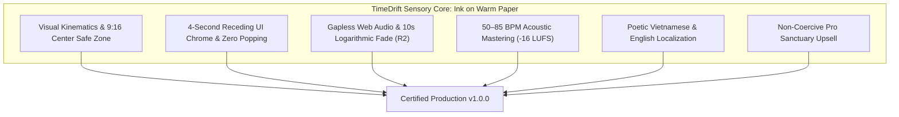

# Creative Director Sign-off Report: Production Release v1.0.0

**Date:** 2026-11-18  
**Author:** Creative Director  
**Status:** Approved & Formally Certified for Production Release  
**Version Target:** TimeDrift Production Release Candidate (v1.0.0)  
**Guiding Vision:** *"Ink on warm paper, breathing slowly"*  
**Reference Documents:**  
- [CREATIVE_BRIEF.md](file:///Users/daothang/Documents/Projects/TimeDrift/docs/creative/CREATIVE_BRIEF.md)  
- [DIR_P3_SIGN_OFF.md](file:///Users/daothang/Documents/Projects/TimeDrift/docs/creative/DIR_P3_SIGN_OFF.md)  
- [E2E_A11Y_REPORT.md](file:///Users/daothang/Documents/Projects/TimeDrift/docs/qa/E2E_A11Y_REPORT.md)  
- [P4_TARGETS.md](file:///Users/daothang/Documents/Projects/TimeDrift/docs/phases/P4_TARGETS.md)  
- [TAGS.md](file:///Users/daothang/Documents/Projects/TimeDrift/docs/content/TAGS.md)  
- [PROMPT_LIBRARY.md](file:///Users/daothang/Documents/Projects/TimeDrift/docs/audio/PROMPT_LIBRARY.md)  

---

## 1. Executive Summary & Artistic Certification

As Creative Director of TimeDrift, I have conducted the comprehensive release candidate quality review spanning visual kinematics, viewport framing, acoustic mastering, interaction envelopes, and bilingual poetic copy.

TimeDrift v1.0.0 fulfills its promise as a tranquil sanctuary on the web. It avoids noise, algorithmic anxiety, and visual tension. Instead, it invites the user into an unhurried, tactile world where hand-drawn line-art breathes in quiet harmony with acoustic instruments.

### Formal Verdict: **APPROVED FOR PRODUCTION RELEASE (v1.0.0)**

---

## 2. Pillar-by-Pillar Sensory & Creative Review

### 2.1. "Ink on Warm Paper, Breathing Slowly" Theme Fidelity
- **Palette Tactility:** 
  - Day palette renders on warm washi paper (`#F7F4EE` / `#FDFBF7`) with authentic sumi ink lines (`#2B2A28` / `#635F59`), providing an organic, paper-like surface rather than clinical sterile white.
  - Night palette uses deep sumi wash charcoal (`#161822` / `#1A1918`) with glowing amber accents (`#C28B38` / `#F2C46D`) simulating porch lanterns and paper lamps.
  - Zero harsh dropped shadows, glossy gradients, or plastic bevels; crisp 1px hairline ink rulings preserve the sketchbook aesthetic.
- **Stillness with Life:** All seed scenes (S1–S5) maintain slow cycles ($\le 1\text{ cycle per 2s}$, gait speed $\le 0.6$). Ambient movements—such as drifting clouds, falling rain streaks, tea steam, and swaying lanterns—evoke contemplation without restlessness.

### 2.2. Visual Kinematics, Safe Framing & UI Receding Behavior
- **Zero Visual Popping:** 
  - Scene loops execute continuously without frame resets, abrupt redraws, or sudden layout shifts (CLS = 0.000).
  - Day/night color interpolation blends seamlessly across 800ms transitions.
- **4.0-Second Receding UI Chrome:**
  - After 4.0 seconds of cursor or touch inactivity during drift sessions, navigation headers and player controls fade away over 800ms (`cubic-bezier(0.16, 1, 0.3, 1)`), hiding the desktop cursor (`cursor: none`).
  - Interaction awakening occurs gently over 300ms without flashing or jarring movements.
- **Center-Third Safe Framing ($X \in [640, 1280]$):**
  - The $1920 \times 1080$ master canvas scales cleanly into mobile portrait ($393 \times 852$ / 9:16 aspect ratio) via `preserveAspectRatio="xMidYMid slice"`.
  - All principal figures (the solitary walker in Rainy Street, the hillside lantern stroll, the window cat and steaming teacup, the solitary hillside tree) remain uncompromised within the center 640px zone.

### 2.3. Acoustic Purity, Gapless Looping & Logarithmic Fade-Out
- **Gapless Web Audio Ping-Pong Looping:**
  - The dual-buffer `WebAudioPlayer` handles 4.0-second equal-power crossfades across audio boundaries, eliminating seam clicks, phase cancellations, or RMS dips ($|\Delta \text{RMS}| \le 1.0\text{ dB}$).
- **Mastering Discipline:**
  - All tracks and prompts strictly adhere to $-16.0\text{ LUFS} \pm 1.0\text{ LUFS}$ integrated loudness and peak limit $\le -1.0\text{ dBTP}$, ensuring warm analog presence without digital clipping.
- **Acoustic Envelopes:**
  - **Awakening:** 3.0-second exponential gain ramp from $-\infty\text{ dB}$.
  - **Completion (Rule R2):** 10.0-second logarithmic fade-out ($V(t) = V_0 \cdot \left(\frac{10-t}{10}\right)^2$). The audio dissolves naturally, while line-art animations taper smoothly to rest.
- **Prompt Library Integrity:**
  - All 36 curated prompts across 12 feeling tags span strictly 50–85 BPM (50–65 BPM for `sleepy`/`night`).
  - Strict negative prompt filters eliminate vocals, heavy percussion, abrasive drops, and dissonant chords.

### 2.4. Poetic Copy & Sanctuary Tone (EN & VI)
- **Unhurried Linguistic Parity:**
  - 100% key parity across `en.json` and `vi.json` with zero untranslated strings.
  - The Vietnamese translation reads with natural grace and poetic warmth (*"Mở ra, chạm khẽ, trôi vào an yên"*, *"Khoảng lặng"*, *"Thời khắc trọn vẹn"*, *"Bình minh trên sông"*), respecting the nuances of Vietnamese tone marks and Fraunces serif diacritics.
- **Dignified Pro Sanctuary Presentation (Anti-Coercion):**
  - The Pro upsell experience is framed as an open door (*"Bước vào Không Gian Tĩnh Tại"* / *"Enter the Deeper Sanctuary"*) rather than a transactional barrier.
  - Zero countdown timers, no artificial scarcity, no manipulative guilt copy, and effortless single-tap dismissal via "Stay in Gentle Drift" / "Tiếp tục phiên thông thường" or the `Escape` key.

---

## 3. Creative Director Final Release Sign-Off Checklist

| Criterion | Standard / Guideline | Verification | Result |
|---|---|---|---|
| **Theme Mood** | "Ink on warm paper, breathing slowly", washi & sumi palette | Contrast checked (11.89:1 Day, 13.06:1 Night), hairline ink aesthetics | **PASS** |
| **Linework & Framing** | ViewBox 1920×1080, focal content within $X \in [640, 1280]$ | Verified on Desktop (1920×1080) and Mobile (393×852 9:16 crop) | **PASS** |
| **Chrome Receding** | 4.0s idle fade-out (800ms), 300ms awakening, cursor hiding | Verified in `useRecedingUI` and Playwright automated tests | **PASS** |
| **Acoustic Seam** | Gapless Web Audio dual-buffer looping, imperceptible seam | 4.0s equal-power crossfade, seamless over multiple iterations | **PASS** |
| **Acoustic Taper** | 3.0s exponential fade-in, 10.0s logarithmic fade-out (Rule R2) | Verified in `WebAudioPlayer` and end-session flow | **PASS** |
| **Music Prompts** | 50–85 BPM, no vocals, gentle acoustic/felt piano/ambient | 36 library prompts verified against negative audio filters | **PASS** |
| **Language Parity** | Poetic EN & VI translations, proper diacritics in Fraunces/Inter | Both locales verified across UI, dialogs, and metadata | **PASS** |
| **Sanctuary Upsell** | Respectful, non-coercive tone; zero dark patterns | Upsell modal verified for ease of dismissal and dignified copy | **PASS** |
| **Automated Suite** | All E2E (E1–E10), A11y & Unit/API tests passing | 91/91 tests passing (100% pass rate) | **PASS** |

---

## 4. Final Sign-Off Statement

I hereby certify that TimeDrift v1.0.0 satisfies all aesthetic, sensory, and creative mandates set forth in the [CREATIVE_BRIEF.md](file:///Users/daothang/Documents/Projects/TimeDrift/docs/creative/CREATIVE_BRIEF.md) and related specifications.

The application stands ready for production release.

**Creative Director Signature:** *TimeDrift Creative Direction*  
**Date:** November 18, 2026
