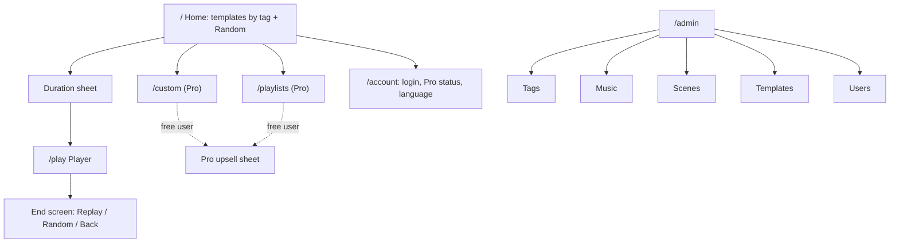

# UX Flows (Owner: Designer)

## Sitemap

## Flow: guest plays a template (US-1)
1. On Home, tap a template card. Its preview thumbnail (the scene frozen at τ=0.3) animates on hover or focus.
2. The duration sheet opens with presets 3 / 5 / 10 / **15** and a slider. Values above 15 show a 🔒 Pro badge, and tapping one opens the Upsell.
3. Tap **Start**. The player goes fullscreen-ready, the audio fades in over 3s, and the scene starts.
4. The player UI hides itself after 3s of no input. Moving the pointer or tapping shows the controls again: ⏸, volume, time left, fullscreen, ✕.
5. When the timer ends, R2 applies and the End screen appears over the dimmed scene.

## Flow: random (US-2)
The Random button on Home and on the End screen goes straight to the duration sheet, with the pair already chosen (its scene and music names are shown).

## Flow: custom pair (US-4, Pro)
Two tabs, Scenes and Music, with tag filter chips. Pick one of each. A sticky bottom bar shows the chosen pair and a Play button. Music previews play for 10s.

## Flow: playlist (US-5, Pro)
List → Edit: add an item (from a template or a custom pair), drag to reorder, set minutes for each item, and see a live total of "X / 720 min" (it turns red above 720 and Save is disabled).

## Flow: admin generate scene (AD-3)
Form → Submit → a job card shows the status, the attempt number (e.g. 1/3) and the model → on READY, a preview iframe plus a source editor (CodeMirror) and Rebuild → Publish.

## States to design
Empty (no templates yet), loading skeletons, job FAILED, offline, Pro expired, omlx unreachable (admin), audio blocked by autoplay ("Tap to start").
