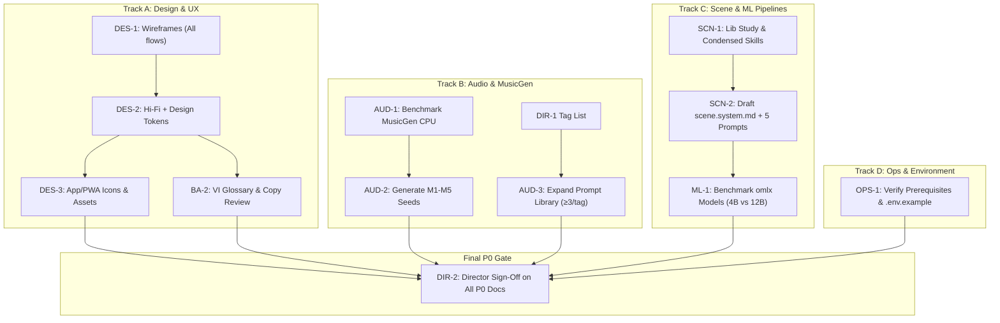

# Phase P0 Targets & Consensus: Preparation & Readiness for Foundation

**Date:** 2026-11-18  
**Participants:** Project Director & Product Manager (PM)  
**Status:** Approved Consensus  

---

## 1. Executive Summary & Objective

The objective of **Phase P0 (Preparation & Readiness for Foundation)** is to eliminate all functional, architectural, technical, aesthetic, and operational ambiguities before code scaffolding begins in Phase P1.

By the end of P0, all system interfaces, contracts, prompts, benchmarks, visual design systems, and business rules must be verified and signed off. **No feature implementation or application code is allowed during P0.**

### Non-Negotiable Exit Criteria for P0
Phase P0 is officially complete and P1 may kick off only when the following 6 gates are satisfied:
1. **Design & UX Complete (`DES-1`, `DES-2`, `DES-3`):** Complete wireframes and hi-fi tokens/components (Day/Night themes) documented, asset specifications exported, and responsive breakpoints locked.
2. **Technical & Environmental Readiness (`OPS-1`):** Target environment verified (Node 22+, Python 3.11, ffmpeg, Chromium headless, SQLite, local omlx endpoint connectivity verified), `.env.example` finalized.
3. **Generative Pipelines Verified (`AUD-1`, `AUD-2`, `AUD-3`, `SCN-1`, `SCN-2`, `ML-1`):**
   - MusicGen-small benchmarked on CPU; M1–M5 seed audio generated, loop-tested, and curated.
   - Scene library evaluated; `scene.system.md` drafted; omlx 4B vs 12B benchmarked on 5 test prompts with pass rate and latency documented; default/fallback model confirmed.
4. **Business & Copy Harmonization (`BA-2`):** Vietnamese/English copy glossary finalized, UI translation strings reviewed, and User Requirement Documents (URDs) detailing P1/P2/P3 behaviors fully fleshed out.
5. **Quality Assurance Readiness (`QA-1`):** Acceptance criteria mapped directly to test scenarios in `docs/qa/TEST_PLAN.md` with explicit validation methods for R1–R12.
6. **Director & PM Sign-off (`DIR-2`):** Formal sign-off on all P0 documentation, seed definitions, creative alignment, and architectural contracts.

---

## 2. Division of Responsibilities & Execution Sequence for Remaining P0 Tasks

To avoid bottlenecks and ensure smooth dependencies leading into P1, tasks are divided into parallel technical and creative tracks:

### Detailed Responsibility Matrix

| Task ID | Role | Key Deliverables & Dependencies | Target Sequence |
|---|---|---|---|
| **OPS-1** | DevOps | Test local omlx (`10.1.123.123:8000`), Python 3.11, ffmpeg, Node 22; produce validated `.env.example`. | Immediate / Day 1 |
| **DES-1** | Designer | Low-fidelity wireframes for Home, Player, Custom Pair, Playlists, Admin, and Modals (Desktop & Mobile). | Immediate / Day 1–2 |
| **AUD-1** | Audio Maker | Benchmark CPU generation time (sec per 30s audio) on target host; record metrics in `docs/audio/AUDIO_GUIDE.md`. | Immediate / Day 1 |
| **SCN-1** | Scene Artist | Deep dive into `vendor/line-art-animation/`; extract constraints, contract boundaries, and compact instructions. | Immediate / Day 1 |
| **SCN-2** | Scene Artist | Author `src/server/prompts/scene.system.md` and 5 standard test prompts. *Depends on SCN-1*. | Day 2 |
| **ML-1** | ML Engineer | Benchmark Qwen3.5-4B-3D-Coder vs Gemma-4-12b-4bit on SCN-2 prompts; document pass rate & latency; confirm model choice. *Depends on SCN-2*. | Day 2–3 |
| **AUD-2** | Audio Maker | Generate seed audio M1–M5, apply crossfade seam fix, ensure peak loudness normalization (-14 LUFS). *Depends on AUD-1*. | Day 2–3 |
| **AUD-3** | Audio Maker | Author at least 3 distinct generative prompts for each of the 12 core emotion tags. | Day 2–3 |
| **DES-2** | Designer | Hi-Fi visual screens, Day/Night theme tokens (Tailwind compatible), component states. *Depends on DES-1*. | Day 2–4 |
| **DES-3** | Designer | PWA icons (192, 512, maskable), favicon, splash screens, empty-state illustrations. *Depends on DES-2*. | Day 4 |
| **BA-2** | BA | Comprehensive English & Vietnamese copy glossary (`messages/en.json`, `messages/vi.json` draft specs) and error message dictionary. *Depends on DES-2*. | Day 4–5 |
| **DIR-2** | Director | Final review of design, prompts, benchmarks, and requirements. Formal approval gate for P1 kickoff. *Depends on all above*. | Day 5 |

---

## 3. Directives for Business Analyst (BA): URDs & Specifications for P0 Exit & P1 Kickoff

To ensure development agents in Phase P1 have complete clarity and zero room for guesswork, the Business Analyst is directed to produce the following specifications prior to P0 closure:

### 3.1. Detailed User Requirements Document (URD) & Flow Breakdowns
The BA must expand upon `docs/ba/REQUIREMENTS.md` with explicit, testable edge-case specifications for:
1. **P1 Foundation Behaviors:**
   - **Auth & Session Matrix:** Guest vs Pro session initialization, persistence across browser refresh, role elevation (`ADMIN_EMAILS`), and expired session handling.
   - **Rule Engine Formalization (R1–R12):** Deterministic specifications for input bounds, boundary clamping, server-side validation error codes, and fallback behaviors (e.g., exact behavior when no tags match in Random mode).
2. **PWA & Offline Specification:**
   - Detailed specification of app shell caching, offline warning banners, and background audio suspension rules when offline.
3. **Admin Content Management URD:**
   - Precise state machine specification for audio and scene pipelines: `DRAFT` $\to$ `VALIDATING` $\to$ `READY` $\to$ `FAILED` $\to$ `PUBLISHED` / `ARCHIVED`.

### 3.2. Translation Glossary & Structured Copy Dictionary (`BA-2`)
- Create an exhaustive mapping of all UI labels, button states, notifications, validation error strings, and tag definitions in both English (`en`) and Vietnamese (`vi`).
- Tone must align with the creative brief: calm, minimalist, unhurried, reassuring (avoid aggressive commercial CTA language).

### 3.3. P1 Acceptance Test Matrix Alignment
- Collaborate with QA to verify that every Acceptance Criteria (AC) in the URD maps 1:1 with test cases in `docs/qa/TEST_PLAN.md` prior to the kickoff of task `BE-3` (Rules Engine) and `FE-1` (Scaffolding).

---

## 4. Creative Director Expectations & Quality Criteria for P0

As guardian of the TimeDrift mood — *"ink on warm paper, breathing slowly"* — the Creative Director establishes the following mandatory requirements and sign-off criteria for design, audio, and scene generation:

### 4.1. Design Expectations: DES-1 (Wireframes) & DES-2 (Hi-Fi Screens & Tokens)
- **Theme Concept:** "Ink on warm paper, breathing slowly".
  - **Palette & Lighting:**
    - Day mode: Warm parchment / rice paper background (`#F9F6F0` to `#F4EFE6`), subtle textured organic feel, soft ink lines (`#2C2A29` to `#3D3A38`), muted earth accents. No harsh pitch blacks or clinical hospital whites.
    - Night mode: Deep indigo/charcoal wash (`#16181D` to `#1E222B`), warm amber / lantern glows (`#E8A857`, `#D97736`) shining softly from windows, lanterns, or stars.
  - **Typography & Layout:**
    - Serene, generous whitespace, unhurried typography. High legibility without aggressive visual hierarchy or screaming CTA buttons.
  - **Player Experience:**
    - Player interface must recede gracefully: controls should fade out into the background during active contemplation/playback so the scene and sound take over.
    - Smooth transitions: Zero jarring jumps, flashes, or harsh UI snaps. All state transitions must use slow, organic fades (300ms–800ms).
  - **Responsive Framing:**
    - Viewbox 1920×1080 (16:9). Wireframes and Hi-Fi screens must demonstrate that the center third remains focal and aesthetically balanced when cropped to 9:16 mobile viewports.

### 4.2. Scene Quality Criteria: SCN-1 (Lib Study) & SCN-2 (Scene Prompts)
- **Stillness with Gentle Life:**
  - Maximum 6 animated figures/elements. Motion must be slow and contemplative (walking gait speed $\le 0.6\times$ normal, oscillation cycle $> 2.0\text{s}$).
  - Strictly no sudden movements, erratic jitter, or distracting high-frequency actions.
- **Contract & Loop Integrity:**
  - Strict compliance with `scene-api` contract (`init(canvas, ctx)`, `update(dt)`, `render(ctx)`, `destroy()`, `onResize(w, h)`).
  - Continuous loops without visible seam, hard reset, or visual teleportation over 3 full cycles.
- **Day/Night Cycle Integration:**
  - Scenes must hook smoothly into `daynight.ts`, dynamically adjusting ink tone and ambient lantern/window glow over a simulated 10–30 minute cycle.
- **Prompt Benchmarking (SCN-2):**
  - The 5 test prompts must represent diverse emotions (`rainy`, `calm`, `nostalgic`, `peaceful`, `night`).
  - Small models (e.g. Qwen 4B) must be provided with unambiguous, highly constrained few-shot patterns that prevent hallucination of forbidden web/DOM APIs.

### 4.3. Audio Quality Criteria: AUD-1 (Benchmark) & AUD-3 (Prompt Library)
- **Acoustic & Dynamic Profile:**
  - BPM capped strictly between 50–85 BPM (50–65 for sleep/night, 65–75 for focus/morning).
  - Keys: Gentle major or modal harmonies (Pentatonic, Dorian, Lydian). Zero dissonance, harsh distortion, or jarring synth transients.
  - Percussion: Exclusively brushed snares, soft muted kicks, or organic textures (rain, vinyl crackle, wind chimes). Absolutely no aggressive drops, EDM rhythms, or heavy bass hits.
- **Loop Seamlessness & Technical QA:**
  - Strict $-16\text{ LUFS}$ integrated loudness, $-1\text{ dBTP}$ true peak.
  - Equal-power 4s crossfade must result in completely inaudible loop seams over 3 consecutive headphone listen cycles.
- **Prompt Coverage (AUD-3):**
  - Minimum 3 distinct, evocative prompts per each of the 12 core emotion tags.
  - Explicit enforcement of negative prompt patterns: `"no vocals, no choir, no epic drops, no intense percussion, loopable, soft dynamics"`.

### 4.4. Director Sign-Off Checklist for DIR-2 Gate
Before granting final approval on P0 and opening P1:
- [x] Tag harmonization: All 5 seed templates share $\ge 2$ tags (River Dawn / M3 tag alignment resolved).
- [ ] DES-1 & DES-2 sign-off: Wireframes and hi-fi screens embody the "ink on warm paper" spirit with graceful control hiding.
- [ ] AUD-1 & AUD-2 sign-off: M1–M5 audio clips audited on headphones with zero audible seams.
- [ ] SCN-2 & ML-1 sign-off: Scene generation system prompt verified with acceptable pass rate on the smallest capable model.
- [ ] Translation review: EN & VI copy preserves the calm, poetic, and respectful tone.

---

## 5. Next Actions
1. **DevOps & Scene Artist / Audio Maker:** Pick up `OPS-1`, `SCN-1`, and `AUD-1` immediately.
2. **Designer:** Begin `DES-1` wireframes based on `docs/design/UX_FLOWS.md` with "ink on warm paper" guidelines.
3. **BA:** Prepare `BA-2` structural skeleton and draft detailed rule tests alongside QA.
4. **PM & Director:** Monitor gate completion and convene at `DIR-2` for formal P1 approval.
