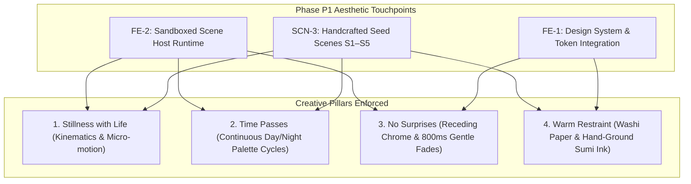
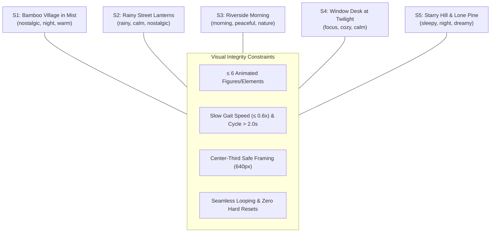

# Phase P1 Targets & Consensus: Foundation

**Date:** 2026-11-18  
**Participants:** Project Director, Tech Lead, Frontend Programmer, Scene Artist, Backend Programmer  
**Status:** Approved Consensus  
**Guiding Creative Vision:** *"Ink on warm paper, breathing slowly"*  

---

## 1. Executive Summary & Objective

The objective of **Phase P1: Foundation** is to transition TimeDrift from concept, documentation, and prompt benchmarks into a live, runnable software architecture. 

During P1, the core tech stack is scaffolded, the database and business rules are anchored, the sandboxed scene runtime host is implemented, and the first five handcrafted living line-art scenes (S1–S5) are built and validated.

### Non-Negotiable Exit Criteria for P1
1. **Frontend Architecture & Design Token Fidelity (`FE-1`):** Next.js 15 App Router scaffolded with Tailwind, next-intl (complete EN/VI key parity), washi paper & sumi ink CSS tokens, Fraunces/Inter typography, and responsive receding UI transitions.
2. **Database, Authentication & Rule Engine (`BE-1`, `BE-2`, `BE-3`):** Prisma schema migrated with SQLite, Auth.js session handling with role promotion, and deterministic validation of business rules R1–R12 covered by 100% unit test pass rates.
3. **Line-Art Animation Lib & Seed Scenes S1–S5 (`SCN-3`):** `vendor/line-art-animation/` integrated, `@timedrift/scene-api` contract defined, and all 5 seed scenes implemented with authentic hand-drawn aesthetics, organic kinematics, and seamless day/night transitions.
4. **Sandboxed Scene Host Runtime (`FE-2`):** `public/scene-host.html` functioning under strict CSP (`sandbox="allow-scripts"`), rendering SVG scenes in a responsive 1920×1080 viewBox with postMessage coordination, zero frame drops, and graceful theme transitions.

---

## 2. Creative Director Guidance for Phase P1

As guardian of the TimeDrift soul — *"ink on warm paper, breathing slowly"* — the Creative Director issues explicit aesthetic requirements and non-negotiable artistic parameters across all P1 deliverables.



---

### 2.1. Aesthetic Implementation in `FE-1`: Design Tokens, Typography & Receding UI

The UI exists solely to frame and serve the art; it must never compete for the user's attention.

#### 1. Washi Paper & Sumi Ink Palette
- **Day Mode (Sunlit Parchment):**
  - Viewport Canvas Base: `--color-paper` (`#F4EFE6`). Warm, natural, slightly unbleached handmade washi paper.
  - Elevated Cards / Surfaces: `--color-paper-light` (`#FDFBF7`).
  - Primary Strokes & Text: `--color-ink` (`#2B2A28`). Soft charcoal sumi ink (never pitch black `#000000`), passing WCAG AAA ($12.3:1$).
  - Secondary Accents: `--color-accent` (`#C28B38`). Ochre / warm sunlit amber for interactive states and focus indicators.
- **Night Mode (Midnight Charcoal Wash):**
  - Viewport Canvas Base: `--color-paper` (`#161822`). Deep indigo-black ink wash (never flat `#000000`).
  - Elevated Surfaces: `--color-paper-light` (`#232734`).
  - Primary Strokes & Text: `--color-ink` (`#EDE9DF`). Warm luminous ivory bone ink, passing WCAG AAA ($13.4:1$).
  - Ambient Lantern Accent: `--color-accent` (`#F2C46D`). Radiating golden lantern glow.
- **Strict Color Rules:**
  - Synthetic neon tones, cold greys, and pure digital blacks (`#000000`) or whites (`#FFFFFF`) are strictly forbidden.
  - Border dividers must be feather-weight sumi hairlines: `1px solid var(--color-ink-muted)` with opacity fallback `border-ink/15`.

#### 2. Responsive Typography & Bilingual Rendering
- **Type Families:**
  - Display / Headings: `Fraunces` Serif (optical sizing `9..144`, weights 400 & 600), evoking traditional literary letterpress.
  - Interface / Body: `Inter` Sans-Serif (weights 400, 500, 600) for neutral clarity.
- **Vietnamese Diacritical Integrity:**
  - Typography must be configured with subsets `['latin', 'vietnamese']` via `@next/font/google` to ensure zero layout shift (CLS 0) and pristine mark alignment for Vietnamese diacritics (`dấu hỏi, ngã, nặng, mũ`).
- **Scale & Spacing:**
  - Follow the modular scale defined in [docs/design/TOKENS.md](file:///Users/daothang/Documents/Projects/TimeDrift/docs/design/TOKENS.md). Generous whitespace and padding must be maintained across all viewports.

#### 3. Receding UI Transition Classes & Inactivity Behavior
- **Inactivity Trigger:** Player controls must automatically recede to `opacity: 0` (`pointer-events: none`) after exactly **4.0 seconds** (`--timer-player-inactivity: 4000ms`) of untouched cursor/touch activity.
- **Easing & Fade:**
  - Fade-out must employ `--ease-gentle` (`cubic-bezier(0.16, 1, 0.3, 1)`) over **800ms** (`--duration-recede: 800ms`).
  - Revealing the UI on pointer movement or keypress must feel immediate yet gentle (`--duration-normal: 250ms`).
  - No harsh snaps or visual cuts are permitted.

---

### 2.2. Creative Integrity of Handcrafted Seed Scenes S1–S5 in `SCN-3`

The seed scenes serve as the aesthetic benchmark and living few-shot exemplars for all future AI generations. Each must feel authentic, hand-drawn, and tranquil.



#### Detailed Scene Artistic Specifications:

1. **S1: Bamboo Village in Mist (*Làng tre trong sương*)**
   - **Tags:** `nostalgic`, `night`, `warm`
   - **Visual Atmosphere:** A quiet hillside village nestled in bamboo groves. At dusk and nightfall, paper lanterns illuminate one by one with a warm amber radiance (`#F2C46D`).
   - **Kinematics:** Maximum 2–3 villagers strolling at slow gait speed ($\le 0.5\times$), planted-foot locomotion without foot slipping. A delicate hanging wind chime sways gently using damped harmonic pendulum physics ($T \approx 4.0\text{s}$).

2. **S2: Rainy Street Lanterns (*Phố mưa lung linh*)**
   - **Tags:** `rainy`, `calm`, `nostalgic`
   - **Visual Atmosphere:** Wet stone alleyway lined with traditional glowing lanterns reflecting upon rainy ground. Steady diagonal rain streaks in fine sumi line-wash.
   - **Kinematics:** A lone figure with an umbrella crossing slowly ($T \ge 6.0\text{s}$). Subtle cyclical umbrella tilt in response to gentle wind. Puddles beneath the lanterns generate concentric ripple rings expanding and fading naturally over 3.0-second intervals.

3. **S3: Riverside Morning (*Sáng bên sông*)**
   - **Tags:** `morning`, `peaceful`, `nature`
   - **Visual Atmosphere:** A wide river at dawn bathed in soft tea-toned morning light. Light mist rises from the water surface. Distant layered mountains sketched in feathery ink washes.
   - **Kinematics:** A wooden boat drifting languidly with gentle river heave ($T \approx 5.5\text{s}$). A lone fisherman casting or leaning into the dawn breeze. Two birds gliding in wide, unhurried sinusoidal arcs across the upper sky.

4. **S4: Window Desk at Twilight (*Bàn bên cửa sổ lúc hoàng hôn*)**
   - **Tags:** `focus`, `cozy`, `calm`
   - **Visual Atmosphere:** An intimate interior desk view overlooking a changing horizon. A steaming cup of green tea on the wooden desk, and a resting cat perched on the windowsill.
   - **Kinematics:** Thin, organic ribbons of tea steam rising and dissolving smoothly using 5th-order minimum jerk polynomials. Cat's tail curled with an occasional slow flick ($T \approx 7.0\text{s}$) and slow chest breathing rhythm ($T \approx 4.5\text{s}$).

5. **S5: Starry Hill & Lone Pine (*Đồi sao và cây thông đơn độc*)**
   - **Tags:** `sleepy`, `night`, `dreamy`
   - **Visual Atmosphere:** An expansive grassy knoll crowned by a solitary ancient pine silhouette beneath a deep midnight sky. Crescent moon and slow-drifting celestial field.
   - **Kinematics:** Golden fireflies hovering near the grass with soft Brownian trigonometric motion. Pine needle clusters swaying with micro-oscillation in high night winds ($T \approx 3.8\text{s}$). Twinkling stars with gentle sinusoidal opacity breathing rather than harsh blinking.

#### Universal Scene Quality Constraints:
- **Element Cap:** Strictly $\le 6$ moving figures/elements per scene.
- **Center-Third Focal Composition:** The core subjects and storytelling elements must fit within the horizontal **640px center band** (`x = 640` to `1280`) of the 1920×1080 viewBox, ensuring zero clipping or disorientation when cropped to 9:16 mobile portrait mode.
- **Deterministic Seeding:** Every scene must instantiate random offsets using Mulberry32 PRNG tied to `opts.seed` (zero raw `Math.random()`).

---

### 2.3. Visual & Contract Standards in `FE-2`: Sandboxed `scene-host.html`

The scene host is the secure architectural bridge that brings the line-art to life in the browser.

#### 1. SVG ViewBox & Aspect Ratio Discipline
- The host SVG must be created with explicit attribute `viewBox="0 0 1920 1080"` and `preserveAspectRatio="xMidYMid slice"`.
- This ensures full-bleed immersive presentation on ultra-wide desktop monitors while maintaining focal balance and letterbox-free aesthetics on tablets and mobile displays.

#### 2. Sandboxing & Security Boundaries (ADR-005)
- Sandboxed iframe specification:
  ```html
  <iframe
    sandbox="allow-scripts"
    src="/scene-host.html"
    class="w-full h-full border-0 absolute inset-0 pointer-events-none"
    tabindex="-1"
    aria-hidden="true"
  />
  ```
- Strictly prohibited attributes: `allow-same-origin`, `allow-top-navigation`, `allow-popups`, `allow-modals`.
- The CSP must enforce complete isolation:
  ```http
  default-src 'none'; script-src 'unsafe-inline' 'self'; style-src 'unsafe-inline'; img-src 'self' data:; connect-src 'none';
  ```
- Generated or seed scene code must never access parent window context, cookies, storage, or external networks.

#### 3. Smooth Day/Night Palette Transitions (`daynight.ts`)
- The host must receive dynamic time progression updates via `postMessage`:
  - `tau` parameter ($\tau \in [0, 1)$): $0.0 = \text{midnight}$, $0.25 = \text{dawn}$, $0.50 = \text{noon}$, $0.75 = \text{dusk}$.
- Dynamic color transitions must be calculated smoothly:
  - Daytime parchment fills (`#F4EFE6`) dissolve into deep slate charcoal washes (`#161822`).
  - Sumi ink lines (`#2B2A28`) transition gracefully into luminous ivory lines (`#EDE9DF`).
  - Warm amber lantern and window fills (`#F2C46D`) activate smoothly as $\tau$ passes dusk, simulating real-world dusk illumination.
- Color interpolation must never jump or strobe across frame boundaries.

#### 4. Performance & Frame Budget
- Single-core CPU utilization must stay $< 30\%$ on modern mobile and desktop processors.
- Frame delta $\Delta t$ must be clamped to $\min(0.1\text{s}, \text{raw\_dt})$ to avoid animation explosion or tearing when recovering from browser tab throttling.
- When `opts.reducedMotion` is true, locomotion and oscillation speed scales down to $\le 0.25\times$ or switches to static contemplative dissolve.

---

## 3. Phase P1 Creative Review & Sign-Off Checklist

Before any P1 task transitions to `DONE`, it must pass the Creative Director's verification checklist:

| Task | Review Target | Required Aesthetic Standard | Status |
|---|---|---|---|
| **FE-1** | Washi & Sumi Palette | Hex tokens match `#F4EFE6`, `#2B2A28`, `#161822`, `#EDE9DF`, `#C28B38`. No synthetic neons or pitch blacks. | PENDING |
| **FE-1** | Typography & Diacritics | Fraunces serif + Inter sans-serif loaded with complete Vietnamese diacritical mark support. Zero CLS. | PENDING |
| **FE-1** | Receding UI Chrome | 4.0s inactivity triggers 800ms gentle ease fade-out. Controls vanish seamlessly. | PENDING |
| **SCN-3** | S1 (Lantern Village) | Lanterns glow at dusk/night; walking gait speed $\le 0.5\times$; wind chime sways naturally. | PENDING |
| **SCN-3** | S2 (Rainy Street) | Rain streaks organic; umbrella walker unhurried; puddle ripple cycles smooth. | PENDING |
| **SCN-3** | S3 (Riverside Morning) | River waves heave gently; boat drifts without reset; morning tea-light atmosphere. | PENDING |
| **SCN-3** | S4 (Window Desk) | Tea steam minimum-jerk fluid rise; cat subtle breathing and tail flick; dusk horizon shift. | PENDING |
| **SCN-3** | S5 (Starry Hill) | Pine tree harmonic sway; fireflies wander organically; stars breathe without blinking. | PENDING |
| **SCN-3** | Mobile Safe Framing | All 5 seed compositions hold visual focus within the central 640px vertical column. | PENDING |
| **FE-2** | Scene Host Sandbox | `sandbox="allow-scripts"` strictly enforced with zero network access and full postMessage contract. | PENDING |
| **FE-2** | Day/Night Transitions | 1920×1080 viewBox; smooth continuous palette shifts across $\tau \in [0, 1)$ without stutter. | PENDING |

---

## 4. Formal Sign-Off to Commence Phase P1

As Creative Director of TimeDrift, I confirm that the aesthetic criteria, token specifications, seed scene artistic designs, and runtime sandboxing rules have been rigorously defined. 

The project vision of **"ink on warm paper, breathing slowly"** is fully documented and safeguarded.

**Decision:** **OFFICIAL CREATIVE SIGN-OFF GRANTED TO BEGIN PHASE P1: FOUNDATION.**
