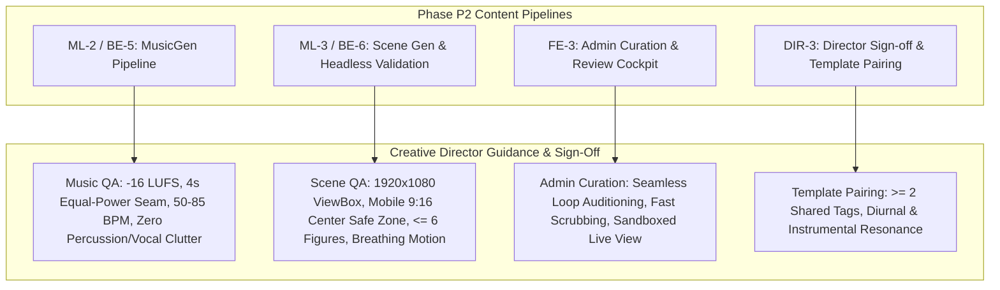
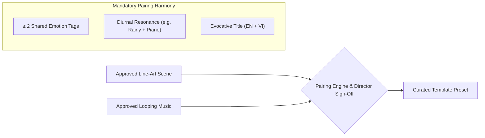

# Phase P2 Targets & Consensus: Content Pipelines

**Date:** 2026-11-18  
**Participants:** Project Director, Creative Director, Tech Lead, ML Engineer, Backend Programmer, Frontend Programmer  
**Status:** In Progress / Draft  
**Guiding Creative Vision:** *"Ink on warm paper, breathing slowly"*  

---

## 1. Executive Summary & Objective

The objective of **Phase P2: Content Pipelines** is to establish TimeDrift's content production machinery:
1. **Audio Generation Pipeline (`ML-2`, `BE-5`):** Running MusicGen-small on CPU to reliably produce warm, looping relax audio with automated seamless crossfading, LUFS loudness mastering, and Ogg Vorbis encoding.
2. **Serial DB Job Queue (`BE-4`):** Solid queue orchestration for CPU-heavy and LLM generation workloads with serial execution per worker type, job recovery, and cancellation.
3. **Scene Generation Pipeline (`ML-3`, `BE-6`):** Calling local omlx models (`Qwen3.5-4B-3D-Coder` with fallback to `gemma-4-12b-4bit`) to generate strict, syntactically and visually sound TypeScript SVG animated scenes.
4. **Automated Headless Scene Validation (`BE-6`):** Headless Chromium verification ensuring strict sandbox compliance, visual motion, minimum SVG node density, and zero runtime errors.
5. **Admin Curation UI & Editorial Review (`FE-3`, `DIR-3`):** Editorial review cockpit allowing the Creative Director and admins to audition music loops, inspect scenes in live sandboxes, test day/night cycles, assemble emotion-coherent templates, and approve or reject content.

---

## 2. Creative Director Guidance for Phase P2

As guardian of the TimeDrift mood — *"ink on warm paper, breathing slowly"* — the Creative Director establishes non-negotiable artistic standards, QA criteria, and curation rules across all content pipelines.

---

### 2.1. Music Generation Creative Guidelines & QA (`ML-2`, `BE-5`, `AUD-2`, `AUD-3`)

Generated relax tracks must never sound synthetic, aggressive, or intrusive. They are sonic blankets intended for sleep, deep focus, and quiet breathing.

#### 1. Audio Aesthetic Specifications
- **Tempo Envelope:** Strict 60–85 BPM for focus and daytime calm; 50–65 BPM for nighttime/sleep tracks. Never exceed 85 BPM.
- **Harmonic & Modal Palette:** Major, pentatonic, Lydian, or gentle Dorian modes. Dissonant clusters, abrupt modulations, tension builds, drops, or jarring transients are prohibited.
- **Instrumental Restraint:**
  - Allowed textures: Felted/soft solo piano, fingerpicked nylon/acoustic guitar, mellow Rhodes with gentle vinyl crackle, warm analog string ensembles (legato), distant ambient synth pads, Tibetan bowls, light nature foley (gentle rain, stream, night crickets, distant wind chimes).
  - Explicit Exclusions: No human vocals (including synthesized choirs, vocal chops, or humming), no brass, no electric guitar distortion, and no heavy percussion. Percussion, if present at all, must be restricted to muted lo-fi kicks, delicate brush snares, or soft wooden shakers.

#### 2. Mastering & Loop QA Standards
- **Loudness Normalization:** Integrated loudness must be strictly normalized to **−16 LUFS** (using `pyloudnorm`), with true peak capped at **−1.0 dBTP**. This ensures zero clipping and volume consistency across random track selection and playlists.
- **Seamless Loop Crossfade:**
  - The worker generates `target_duration + 4` seconds.
  - The final 4 seconds are crossfaded into the initial 4 seconds using an **equal-power crossfade curve** (`sin/cos` power curve, not a linear slope), aligned at the nearest zero-crossing point.
  - **Inaudibility Test:** A track fails QA if any pop, click, phase cancellation, noticeable volume dip, or rhythmic hiccup is audible over **3 consecutive loops** on reference monitoring headphones.
- **Encoding:** Compressed with `ogg vorbis q5` (~80 kbps) at 32 kHz mono to preserve warmth while guaranteeing rapid streaming and zero memory bloat.

---

### 2.2. Scene Generation Creative Guidelines & Headless Validation (`ML-3`, `BE-6`, `SCN-2`, `SCN-3`)

TimeDrift scenes are living digital ink paintings on handcrafted washi paper. Every generated scene must feel alive yet meditative.

#### 1. Canvas Framing & Composition Geometry
- **ViewBox Spec:** Strict `viewBox="0 0 1920 1080"` (16:9 landscape aspect ratio).
- **Mobile 9:16 Center-Third Safe Framing:**
  - Mobile devices crop the 16:9 canvas to 9:16 center-cut (coordinate region $x \in [660, 1260]$, $y \in [0, 1080]$).
  - The focal narrative elements (e.g. seated reader, glowing tea stall, lantern, resting cat, pine tree) **must reside entirely within this center 600px safe zone**.
  - Flanking edges ($x < 660$ and $x > 1260$) provide peripheral atmosphere (distant mountain silhouettes, bamboo groves, mist washes, star fields). Peripheral elements must balance the composition without trapping essential subjects.

#### 2. Motion, Kinematics & Density Constraints
- **Figure Limit:** Maximum of **6 animated figures/elements** per scene (`<= 6`). Clutter destroys stillness.
- **Organic Breathing Kinematics:**
  - Motion cycle speed must be slower than 1 full cycle per 2.0 seconds ($\le 0.5 \text{ Hz}$).
  - Walking figures must move at gait speed $\times 0.6$ or slower.
  - Swaying lanterns, drifting mist particles, rippling water strokes, and gentle foliage rustling must emulate slow, unhurried breathing.
  - No erratic twitching, rapid bouncing, or mechanical linear paths.
- **Deterministic PRNG:** Randomness must derive exclusively from the seeded Mulberry32 PRNG supplied in `SceneOpts.seed`. Scenes must render deterministically given the same seed.
- **Diurnal Continuity (`daynight.ts`):**
  - Scene colors must bind dynamically to the continuous diurnal parameter $\tau \in [0, 1]$ (`tau`).
  - Seamless day-to-night transitions without palette flash or visual snapping. Night cycles must render luminous sumi ink washes with warm amber/ochre glowing accents (`#F2C46D` / `#C28B38`) radiating from lanterns, hearths, or paper windows.

#### 3. Automated Validation Gates (`BE-6`)
Before any generated scene reaches the admin review queue, the automated validator must enforce:
1. Clean TypeScript compilation against `@timedrift/scene-api` and `vendor/line-art-animation/lib`.
2. Safe bundle generation (`esbuild --bundle --format=esm --minify`).
3. Headless Chromium execution for 3.0 seconds inside `public/scene-host.html`:
   - Zero uncaught exceptions or console errors.
   - SVG DOM node count $\ge 20$ child elements (prevents blank/stunted outputs).
   - Frame-to-frame pixel differential $> 0$ (verifies active animation, not a static image).
   - Single-core CPU load $< 30\%$ on baseline hardware.

---

### 2.3. Admin Curation Cockpit & Review Experience (`FE-3`, `DIR-3`)

The Admin Curation interface is an editorial sanctuary where the Creative Director and Curators review, tweak, and approve content before public broadcast.

#### 1. Audio Auditioning Controls
- **Seamless Loop Player:** One-click continuous 3-loop playback mode with an auto-scrub loop seam inspector (jumping instantly to $-5\text{s} \to +5\text{s}$ relative to the loop boundary).
- **Aesthetic Metric Display:** Prominent readouts for Integrated LUFS, True Peak, BPM, Track Duration, and Emotion Tag badges.
- **Audio Retake Actions:** Direct triggers for "Regenerate with same prompt", "Tweak prompt tags", and "Discard track".

#### 2. Live Scene Sandbox Inspector
- **Interactive Sandboxed Host:** Real-time iframe preview rendered strictly with `sandbox="allow-scripts"` and TimeDrift's restrictive CSP.
- **Time-Scrubber ($\tau$ Slider):** High-speed slider allowing the curator to scrub $\tau$ from $0.0$ to $1.0$ (midnight $\to$ dawn $\to$ noon $\to$ dusk $\to$ midnight) to verify palette gradations, lantern ignitions, and sun/moon arcs in seconds.
- **Speed Multiplier Controls:** `0.25x`, `1.0x`, `2.0x`, and `10.0x` speed controls to test loop boundaries, cyclical stability, and figure trajectory resets.
- **9:16 Mobile Viewport Overlay:** Toggleable visual overlay displaying the central 9:16 aspect ratio guides to confirm safe-zone composition instantly.

#### 3. Editorial Actions & Tag Hygiene
- **Approve / Reject / Revise Workflow:**
  - `APPROVE`: Transitions item state to `PUBLISHED` (or staging template library).
  - `REJECT`: Immediately archives generation artifacts with a mandatory single-click rejection reason (e.g. "Percussion too harsh", "Seam audible", "Figure count exceeded", "Erratic motion", "Off-center composition").
  - `REVISE`: Allows manual metadata adjustments (bilingual title refinement, tag re-assignment).
- **Bilingual Title Validation:** Every item must have both English (`name_en`) and Vietnamese (`name_vi`) poetic titles present before approval.

---

### 2.4. Template Assembly & Sign-Off Criteria (`DIR-3`)

Templates are pre-composed pairings of one animated Scene and one looping Relax Track. They represent TimeDrift’s signature turnkey experience.

#### 1. Pairing Resonance Rules
- **Tag Overlap:** Scene and Music must share **at least 2 emotion tags** from `docs/content/TAGS.md` (a single shared tag is permitted only if accompanied by an explicit artistic justification recorded in the admin note).
- **Atmospheric & Diurnal Alignment:**
  - Rain/Night scenes $\longleftrightarrow$ Soft solo piano, ambient pads, warm rain foley.
  - Morning/Meadow scenes $\longleftrightarrow$ Fingerpicked acoustic guitar, gentle Rhodes, dawn birds.
  - Deep Twilight/Stargazing scenes $\longleftrightarrow$ Slow evolving strings, music-box, ethereal synth washes.
  - Tea/Study scenes $\longleftrightarrow$ Mellow lo-fi hip hop with muted kick and vinyl crackle.

#### 2. Creative Director Sign-Off Checklist (`DIR-3`)
A template receives the final Director Sign-Off stamp only when all boxes are checked:

- [ ] **Mood Authenticity:** Emulates *"ink on warm paper, breathing slowly"*. Zero aggression, tension, or discordance.
- [ ] **Visual Tranquility:** Scene respects $\le 6$ figures, slow gait/breathing cycles, and pristine 9:16 central framing.
- [ ] **Auditory Cleanliness:** Music adheres to −16 LUFS, has zero audible seam over 3 loops, and possesses no vocals or harsh drums.
- [ ] **Diurnal Grace:** Scene transitions effortlessly across all $\tau$ values without color clipping or jarring light pop.
- [ ] **Bilingual Resonance:** Titles in both English and Vietnamese are poetic, grammatically pristine, and emotionally evocative.
- [ ] **Tag Integrity:** 2+ shared tags genuinely reflect the sensory feeling of the combined composition.
