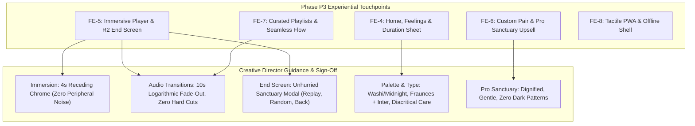
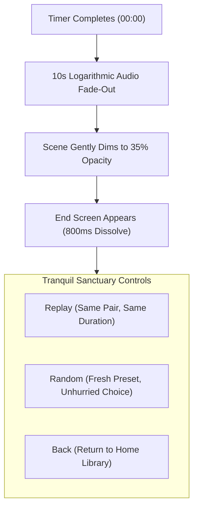

# Phase P3 Targets & Consensus: User Experience

**Date:** 2026-11-18  
**Participants:** Project Director, Creative Director, Tech Lead, Frontend Programmer, Backend Programmer, QA Engineer, DevOps  
**Status:** In Progress / Draft  
**Guiding Creative Vision:** *"Ink on warm paper, breathing slowly"*  

---

## 1. Executive Summary & Objective

The objective of **Phase P3: User Experience** is to bring the end-user facing relax sanctuary to life across desktop, tablet, and mobile devices:
1. **Home, Discovery & Duration Sheet (`FE-4`, `BE-7`):** Turnkey template exploration catalogued by feeling tags, instant Random pairing engine, and frictionless duration selection (3–15 min for guests, unlocked up to 720 min for Pro).
2. **Immersive Living Player (`FE-5`):** Complete player runtime featuring sandboxed line-art scene hosting, gapless Web Audio looping, screen wake lock, media session integration, auto-receding chrome, gentle fades, and tranquil end screen handling (R2).
3. **Custom Pairing & Serene Pro Upsell (`FE-6`, `BE-7`):** Unrestricted scene + music pairing workbench for Pro subscribers, complemented by a dignified, calm, non-coercive upsell sheet.
4. **Curated Playlists & Seamless Sequencing (`FE-7`, `BE-7`):** Multi-item continuous journeys up to 720 minutes with 3-second equal-power crossfades between scene/audio pairs.
5. **PWA & Offline App Shell (`FE-8`):** Installable, tactile web application with offline shell caching, bespoke SVG maskable icons, and splash screens honoring the washi paper palette.

---

## 2. Creative Director Guidance for Phase P3

As guardian of the TimeDrift mood — *"ink on warm paper, breathing slowly"* — the Creative Director sets forth the core experiential principles, aesthetic rules, motion envelopes, and sign-off criteria governing all user-facing interactions in Phase P3.

---

### 2.1. Immersion & Chrome Receding Dynamics (`FE-5`)

A relax application must never compete with its own content. When the user initiates a session, interface clutter must gracefully dissolve, allowing the living line-art and looping sonic blanket to fill the user's perception entirely.

#### 1. The 4-Second Receding Rule
- **Initial Presentation:** Upon entering `/play`, the minimal player controls (play/pause, elapsed/remaining time ring, volume slider, fullscreen toggle, exit glyph) are visible.
- **Inactivity Timer:** After **4.0 seconds** of zero pointer, touch, or keyboard activity, the entire UI chrome must fade out to `opacity: 0` using a gentle `800ms ease-out` curve.
- **Pure Canvas State:** In the recessed state, no UI elements, button outlines, badges, or scrollbars remain visible. The viewport belongs exclusively to the animated SVG line-art and the ambient audio.
- **Subtle Awakening:** Any cursor movement, screen tap, or key press immediately awakens the controls via an `opt-in` `300ms ease-in` transition. Controls must never "snap" or flicker into existence.
- **Pointer Auto-Hide:** On desktop viewports, the mouse cursor itself must set `cursor: none` after the 4-second timeout to prevent stray arrows hovering over contemplative scenes.

---

### 2.2. Audio Envelope & Transition Philosophy (`FE-5`, `FE-7`)

Jarring stops, clicks, pops, and sudden silence trigger subconscious alertness and break the meditative trance. TimeDrift enforces strict acoustic tapering across all state transitions.

#### 1. Session Start (Fade-In)
- When playback begins (triggered by user gesture per browser autoplay policies), audio must smoothly ramp from $-\infty\text{ dB}$ ($0.0$ gain) to nominal listening volume over **3.0 seconds** using an exponential / logarithmic curve.

#### 2. Session Completion (10-Second Logarithmic Fade-Out, Rule R2)
- At the exact expiration of the wall-clock session timer:
  - Audio must **not** cut abruptly.
  - A gentle **10.0-second logarithmic fade-out** curve ($V(t) = V_0 \cdot \left(\frac{10 - t}{10}\right)^2$ or Web Audio `exponentialRampToValueAtTime`) begins immediately.
  - The scene animation continues its natural breathing cycle during the 10-second fade, slowing gently to a tranquil rest posture rather than freezing mid-stroke.
  - This 10-second taper allows the nervous system to gradually surface without shock.

#### 3. Playlist Item Sequencing (3-Second Equal-Power Crossfade)
- In playlist mode (`FE-7`), transitioning between adjacent pairs must execute an equal-power crossfade over **3.0 seconds**:
  $$\text{Gain}_{\text{out}}(t) = \cos\left(\frac{\pi t}{2 \cdot 3}\right), \quad \text{Gain}_{\text{in}}(t) = \sin\left(\frac{\pi t}{2 \cdot 3}\right)$$
- Scene crossfading must blend via an 800ms opacity dissolve, preventing black flash or layout shifts.

---

### 2.3. The Tranquil End Screen Experience (`FE-5`, Rule R2)

The end of a session is not an interruption; it is a gentle awakening. The End Screen modal must embody warmth, gratitude, and stillness.

#### 1. Visual Presentation & Hierarchy
- **Backdrop:** The active line-art scene dims to 35% opacity beneath a warm washi paper overlay (`rgba(244, 239, 228, 0.75)` in day mode; `rgba(30, 34, 51, 0.85)` in midnight mode).
- **Tone & Copy:** A quiet, centered reflection line (e.g., *"Session complete. Take a gentle breath before returning."* / *"Phiên hoàn tất. Giữ một nhịp thở nhẹ trước khi tiếp tục."*).
- **Control Layout:** Three unhurried, generous touch targets:
  1. **Replay:** Restarts the same scene/audio pair for another run with the same duration.
  2. **Random:** Curates a fresh, harmonious pairing ready for another session.
  3. **Back:** Returns peacefully to the Home library catalog.
- **Zero Pressure:** No countdowns, no auto-redirects, no popups, no intrusive analytics prompts, and no score badges. The user may rest on the End screen as long as they wish.

---

### 2.4. Home, Library & Tactile Typography (`FE-4`)

The TimeDrift catalog must feel like browsing hand-bound sketchbooks in a sunlit wooden library.

#### 1. Color Palette Tokens & Atmosphere
- **Day Palette (`--paper` / `--ink`):**
  - Background: Warm natural washi paper (`#F4EFE4`).
  - Text & Strokes: Deep ground sumi ink (`#2B2A28`), softened secondary text (`#6B665E`).
  - Accents: Honey amber glow (`#E0A458`).
- **Night / Midnight Palette (`--paper` / `--ink`):**
  - Background: Midnight charcoal (`#1E2233`).
  - Text & Strokes: Luminous parchment ink (`#E6E1D3`), muted bone (`#9A9789`).
  - Accents: Warm paper lantern ochre (`#F2C46D`).
- **Borders & Dividers:** No dropshadows or skeuomorphic plastic bevels; exclusively crisp 1px `--ink-soft` hairlines resembling fine pen strokes.

#### 2. Authentic Diacritical Typography
- **Headings:** **`Fraunces`** (soft, organic optical serif with variable warmth).
- **Body & Controls:** **`Inter`** (clean, ultra-legible neutral sans).
- **Vietnamese Diacritic Integrity:** Both fonts must include full Latin Extended glyph coverage ensuring pristine rendering of complex Vietnamese tone markers and vowel combinations (`ơ`, `ư`, `ắ`, `ề`, `ộ`, `đ`) with zero font fallback glitches or vertical alignment jumps.

#### 3. Feeling Tags Navigation
- Navigation organizes around emotional states rather than mechanical search queries:
  - Tags: `#calm`, `#focus`, `#sleep`, `#rain`, `#night`, `#coffee`, `#nature`, `#lofi`.
  - Pill-shaped chip buttons (`border-radius: 999px`) that highlight with an organic sumi wash when active.
  - Hover states animate preview thumbnails gently at $\tau=0.3$.

---

### 2.5. Pro Sanctuary Upsell: Dignified & Respectful (`FE-6`)

TimeDrift treats every visitor as a guest seeking peace. The Pro upsell must never resort to hostile dark patterns, aggressive modals, guilt-tripping countdowns, or deceptive pricing tricks.

#### 1. Architectural Philosophy
- **Frictionless Free Tier:** Guests and free users enjoy full, unhindered access to all published templates up to 15 minutes per session, with zero session count caps.
- **The "Sanctuary" Concept:** Pro unlocks extended journeys (up to 720 min / 12 hours), the Custom Pairing laboratory, and Curated Playlists.

#### 2. The Upsell Sheet / Dialog Specification
- **Trigger Points:** 
  - Selecting a duration $> 15$ min on the Duration Sheet.
  - Visiting `/custom` or `/playlists` as an unauthenticated or non-Pro user.
- **Aesthetic Tone:** A quiet bottom sheet (mobile) or centered parchment dialog (desktop) with generous whitespace.
- **Copy & Tone:** Frame Pro as an invitation to deepen one's sanctuary:
  - Headline: *"Deepen your quiet space."* / *"Mở rộng không gian tĩnh lặng."*
  - Benefits stated in calm bullet points: *Unbroken sessions up to 12 hours*, *Custom scene & music pairings*, *Curated sequential playlists*.
  - Pricing: Transparent, honest monthly or annual pricing with no fake urgency ("Only 2 hours left!") or flashing banners.
- **Effortless Dismissal:** A clear, visible "Continue with 15 minutes" or "Maybe later" ghost button. Pressing `Escape` or tapping outside immediately closes the sheet without guilt-inducing confirmation prompts.

---

### 2.6. Creative Director P3 Review & Sign-Off Checklist

Before any user-facing feature in Phase P3 is marked `DONE`, it must satisfy the following Creative Director checklist:

- [ ] **Immersion & Chrome Recede:** Player UI fades completely after 4.0 seconds of silence; cursor auto-hides; waking is smooth and organic (no snapping).
- [ ] **Acoustic Serenity:** Audio fades in over 3s, fades out over 10s on timer completion; zero clicks, pops, or harsh cutoffs.
- [ ] **End Screen Grace:** End screen presents a tranquil, dim-lit sanctuary with Replay, Random, and Back controls; zero aggressive calls to action.
- [ ] **Visual Identity & Contrast:** Day (washi paper `#F4EFE4`) and Night (midnight `#1E2233`) themes maintain WCAG 2.2 AA contrast with 1px ink hairlines and zero heavy shadows.
- [ ] **Typographic Harmony:** `Fraunces` headings and `Inter` body text render Vietnamese diacritics flawlessly without font popping.
- [ ] **Pro Sanctuary Dignity:** Upsell sheet is respectful, quiet, easy to dismiss, and completely free of manipulative marketing patterns.
- [ ] **PWA Tactile Presence:** Mobile home screen icon, splash screen, and offline fallback evoke a hand-crafted art object.
