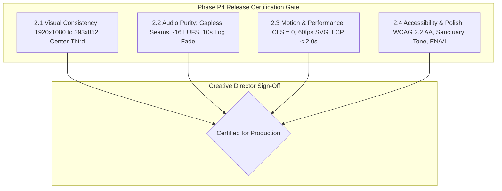

# Phase P4 Targets & Consensus: Hardening & Release

**Date:** 2026-11-18  
**Participants:** Project Director, Creative Director, Tech Lead, QA Engineer, DevOps, Frontend Programmer, Backend Programmer  
**Status:** In Progress / Draft  
**Guiding Creative Vision:** *"Ink on warm paper, breathing slowly"*  

---

## 1. Executive Summary & Objective

The objective of **Phase P4: Hardening & Release** is to certify, stress-test, and deploy TimeDrift for production release with zero aesthetic compromises, zero audio artifacts, rock-solid security, and unflinching performance:
1. **End-to-End System Verification (`QA-2`):** Rigorous Playwright automation covering scenarios E1–E10 across desktop and mobile form factors, validating business rules R1–R12, session life cycles, locale persistence, and error resilience.
2. **Device Matrix, Visual Fidelity & Accessibility Audit (`QA-3`):** Manual and automated auditing across macOS (Safari, Chrome, Firefox), iOS Safari, Android Chrome, and Windows; ensuring strict WCAG 2.2 AA compliance, screen reader fluidity, and keyboard navigation.
3. **Production Containerization & Orchestration (`OPS-2`):** Production Docker Compose deployment (Next.js web host + Python MusicGen worker), Nginx reverse proxy with TLS termination, and strict container isolation.
4. **Operations, Observability & Data Integrity (`OPS-3`):** Automated database and audio storage backups, health check telemetry (`/api/health`), structured logging, and log rotation.
5. **Release Governance & Launch Gate (`PM-2`):** Comprehensive go/no-go audit, verifying zero P1/P2 defects, pristine EN/VI linguistic parity, and full Creative Director sign-off on published templates, music loops, and line-art scenes.

---

## 2. Creative Director Guidance for Phase P4

As guardian of the TimeDrift mood — *"ink on warm paper, breathing slowly"* — the Creative Director defines the non-negotiable aesthetic, sensory, and experiential standards required for production release.

---

### 2.1. Visual Consistency & Viewport Composition Standards

TimeDrift scenes are contemplative hand-drawn masterworks. They must maintain intentional, uncompromised composition regardless of whether they are viewed on a 4K cinema display or a narrow mobile smartphone.

#### 1. Dual-Target Viewport Geometry
- **Primary Desktop Baseline:** `1920 × 1080` (16:9 widescreen landscape). Full spatial breathing room, expansive negative space (ma / 間), subtle horizon details, and delicate ambient particles.
- **Primary Mobile Baseline:** `393 × 852` (9:16 portrait viewport, typical modern flagship mobile).

#### 2. The 9:16 Center-Third Safe Zone Mandate
- When the 16:9 canvas is viewed on mobile devices, the scene container crops to portrait orientation via center alignment:
  - The horizontal center third — coordinates $X \in [640, 1280]$ in the $1920\text{px}$ viewBox — represents the **Sacred Safe Zone**.
  - **Focal Integrity:** Every primary animated figure (the solitary tea drinker, the sleeping cat, the swaying porch lantern, the bonsai tree) and essential interaction focal point must be strictly framed within $X \in [640, 1280]$.
  - **Crop Certification:** When cropped to 9:16 portrait, figures must never suffer awkward bisections, decapitations, or off-center visual weight imbalances.
  - **Edge Periphery:** Elements outside the center third ($X < 640$ and $X > 1280$) must serve strictly as contextual atmosphere (distant mountain silhouettes, continuous fence lines, falling raindrops, drifting leaves).

#### 3. Zero-Artifact Canvas Scaling
- SVG rendering must use `preserveAspectRatio="xMidYMid slice"` inside the sandbox iframe host to ensure uniform geometric scaling without distortion.
- Stroke widths must scale harmoniously or utilize `vector-effect: non-scaling-stroke` where appropriate to prevent linework from turning coarse on mobile or hair-thin on desktop.
- No scrollbars, horizontal overflow, or unintended clipping masks may appear on any certified viewport.

---

### 2.2. Audio Quality & Acoustic Purity Standards

Audio in TimeDrift is not background music; it is an intimate sonic sanctuary. Digital glitches, audible loop seams, harsh frequencies, or abrupt level jumps instantly shatter the user's meditative state.

#### 1. Gapless Seamless Looping
- **Loop Seam Imperceptibility:** Tracks loop continuously for sessions lasting up to 720 minutes. The loop transition ($t_{\text{end}} \to t_{\text{start}}$) must be **audibly undetectable**:
  - Zero digital clicks, zero phase cancellations, zero waveform discontinuities ($|x[\text{end}] - x[0]| < \epsilon$).
  - RMS volume across the 4-second equal-power crossfade window must remain stable within $\pm 1.0\text{ dB}$, preventing audible "pumping" or breathing volume dips at seam boundaries.
  - Harmonic resolution: The chord progression at loop end must resolve smoothly back to the root or tonic pedal of loop start.

#### 2. Mastering & Loudness Discipline
- **Integrated Loudness:** Strictly mastered to $-16.0\text{ LUFS} \pm 1.0\text{ LUFS}$ per ITU-R BS.1770-4.
- **True Peak Ceiling:** Maximum peak must not exceed $-1.0\text{ dBTP}$ to prevent inter-sample clipping across DACs and mobile speaker transducers.
- **Spectral Warmth:** High-frequency cut/shelf above $12\text{ kHz}$ to eliminate digital fizz and harsh sibilance. Low-frequency shelf below $40\text{ Hz}$ to prevent sub-rumble on headphones.

#### 3. Fade-In and 10-Second Fade-Out Smoothness (Rule R2)
- **Session Awakening (Fade-In):** On player start, audio gain ramps from silence ($0.0$) to target level over **3.0 seconds** using an exponential curve, gently welcoming the listener.
- **Tranquil Completion (Fade-Out):** At session timer expiration, the audio must execute an uninterrupted **10.0-second logarithmic fade-out** ($V(t) = V_0 \cdot \left(\frac{10-t}{10}\right)^2$ or Web Audio `exponentialRampToValueAtTime`).
  - No abrupt cuts, no trailing echo truncation, and no sudden muting.
  - The scene animation breathes down gracefully during this 10-second taper, providing an unhurried, respectful transition from deep focus back to waking consciousness.

#### 4. Playlist Crossfade Continuity (`FE-7`)
- Multi-track playlist transitions must execute an equal-power 3.0-second crossfade ($\cos/\sin$ gain curve) with zero audible volume drops at the midpoint ($0.707$ gain per channel).

---

### 2.3. Performance, Motion Envelopes & Rendering Fluidity

Sluggishness, stuttering, and layout shifts destroy the organic illusion of "hand-drawn ink breathing slowly."

#### 1. Layout Stability & Instant Load
- **Cumulative Layout Shift (CLS):** Must be strictly **$0.000$** across all page loads, modal opens, and responsive resizes.
- **Font Rendering:** Web fonts (`Fraunces` and `Inter`) must load via Next.js Font Optimization with zero font-swap flash (FOIT/FOUT) and pre-calculated font metric fallbacks.
- **Largest Contentful Paint (LCP):** Must clock under **$2.0\text{s}$** on average 4G networks.
- **Player Shell Initialization:** Sandboxed iframe host must mount and render the first frame of line-art in under **$300\text{ms}$** from player entry.

#### 2. 60 FPS Fluid Line-Art Kinematics
- Animated line-art SVGs must sustain a solid **60 frames per second** (or device native display refresh rate, e.g., 120Hz ProMotion) without dropped frames during:
  - Continuous cyclic motion (walking figures, swaying lanterns, ripple waves).
  - Day/night color interpolation transitions.
  - UI chrome fade-in/fade-out animations.
- **Lightweight DOM Footprint:** Animated scenes must maintain an efficient DOM profile:
  - $\le 6$ active animated figures.
  - $\le 250$ total SVG DOM nodes per scene to prevent mobile GPU/CPU thermal throttling or battery drain during extended 720-minute sessions.
- **Hardware Acceleration:** All CSS transforms and opacity transitions must be composite-only (`transform`, `opacity`, `will-change: transform`).

---

### 2.4. Accessibility, Bilingual Polish & Sanctuary Tone

TimeDrift is built as a peaceful sanctuary accessible to all humans. Dignified restraint and inclusivity must be reflected across every color pair, screen reader label, and translated phrase.

#### 1. WCAG 2.2 AA Contrast Compliance
- **Text & Core Interactive Controls:** Strict minimum contrast of **$4.5:1$** against backgrounds:
  - *Day Mode:* Hand-ground sumi ink (`#2B2A28`) on warm washi paper (`#F4EFE6`) yields an exemplary **$12.3:1$** contrast ratio.
  - *Night Mode:* Soft parchment ink (`#EDE9DF`) on deep sumi wash (`#161822`) yields **$13.4:1$** contrast ratio.
- **Focus Rings:** Distinctive, non-destructive **$3.0:1$** warm ochre (`#C28B38` / `#F2C46D`) focus rings on all interactive elements, visible during keyboard navigation (`Tab` / `Shift+Tab`) and auto-suppressed on mouse click.
- **Reduced Motion (`prefers-reduced-motion: reduce`):** UI transitions collapse to instant or gentle 150ms opacity dissolves; scene animations slow down to static or micro-drifts without sudden flashes.

#### 2. Respectful Sanctuary Pro Tone (Anti-Coercion)
- **Zero Dark Patterns:** No countdown clocks, no artificial urgency ("Only 2 hours left!"), no disguised buttons, and no shaming copy ("No thanks, I don't want to relax").
- **Dignified Paywall Presentation:** Pro upsell sheets must read like a quiet invitation into a deeper sanctuary, using elegant Fraunces typography, tranquil benefits bulleting, and effortless dismissal (`Esc`, tap backdrop, or "Maybe later").

#### 3. Bilingual Copy Perfection (English & Vietnamese)
- **Zero Raw English Strings:** Every single user-facing label, tooltip, aria-label, validation error, and empty state must pass through `next-intl` with 100% parity across `en.json` and `vi.json`.
- **Vietnamese Diacritical & Typographic Grace:**
  - Vietnamese copy must be natural, poetic, and soothing — not robotic machine translation (e.g., using *"Khoảng lặng"* for sanctuary, *"Thư thái"* for unwind, *"Chạm để tiếp tục"* for gentle action).
  - Proper diacritical typesetting with Fraunces and Inter: zero clipped accent marks (dấu hỏi, ngã, nặng, mũ) and zero ugly fallback glyph substitution across all viewports.

---

### 2.5. Creative Director Pre-Release Sign-Off Checklist

Before any production deployment or general release approval (`PM-2`), the Creative Director must verify and sign off on this checklist:

| Quality Dimension | Verification Item | Standard / Threshold | Sign-Off Status |
|---|---|---|---|
| **Visual** | Desktop composition (1920×1080) | Balanced negative space, delicate linework, zero clipping | [ ] PENDING |
| **Visual** | Mobile safe-zone crop (393×852) | Essential figures within center $X \in [640, 1280]$, zero bisections | [ ] PENDING |
| **Visual** | Day/Night transition cycle | Harmonious color interpolation, lantern glow feels warm, not garish | [ ] PENDING |
| **Audio** | Gapless loop seam | 3 consecutive loops auditioned; seam is audibly imperceptible | [ ] PENDING |
| **Audio** | Mastering loudness | $-16\text{ LUFS} \pm 1.0$, true peak $\le -1\text{ dBTP}$, zero digital clipping | [ ] PENDING |
| **Audio** | Timer fade-out (R2) | Smooth 10.0-second logarithmic decay to pure silence | [ ] PENDING |
| **Motion** | Chrome receding dynamics | 4.0s idle $\to$ 800ms gentle fade-out; mouse cursor hides | [ ] PENDING |
| **Motion** | Frame rate stability | Steady 60fps SVG rendering; zero frame drops during loop resets | [ ] PENDING |
| **Performance** | Layout shift & load | CLS = 0.000; scene iframe boots and paints in $<300\text{ms}$ | [ ] PENDING |
| **A11y** | WCAG 2.2 AA Contrast | Text $\ge 4.5:1$, focus outlines visible, full keyboard traversable | [ ] PENDING |
| **Copy & Tone** | Sanctuary voice | Dignified, tranquil copy; zero pressure or dark patterns | [ ] PENDING |
| **i18n** | EN / VI Linguistic parity | 100% keys translated; flawless Vietnamese diacritics & tone | [ ] PENDING |
